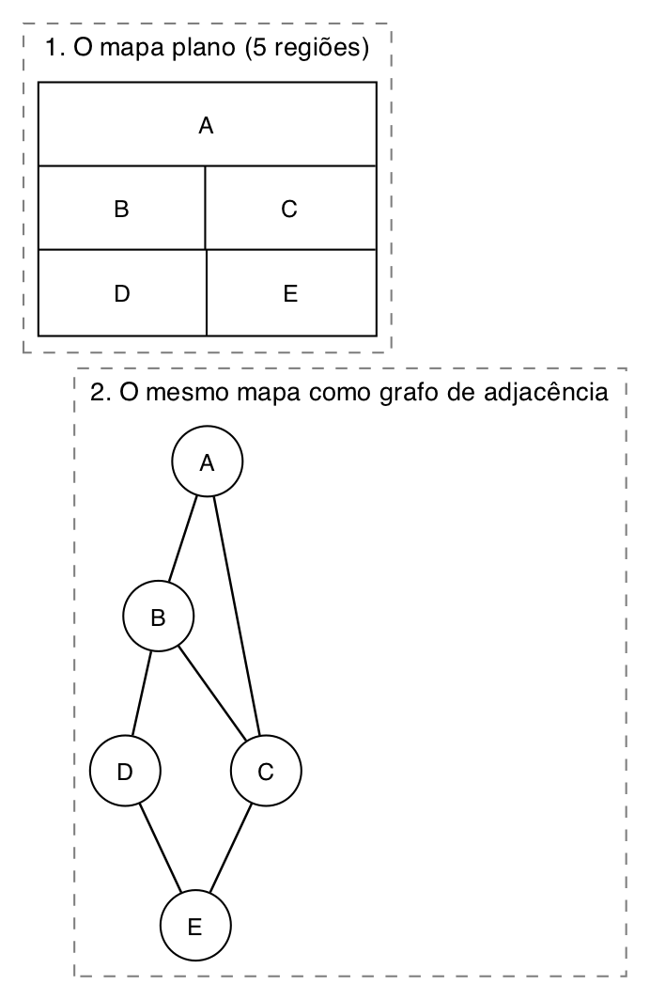
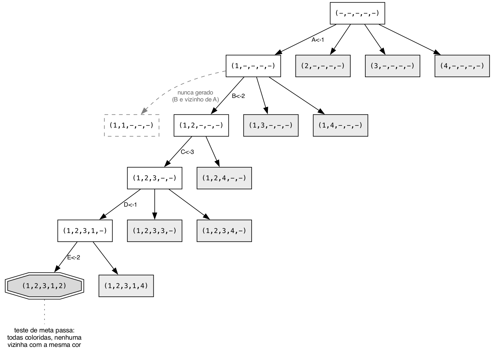
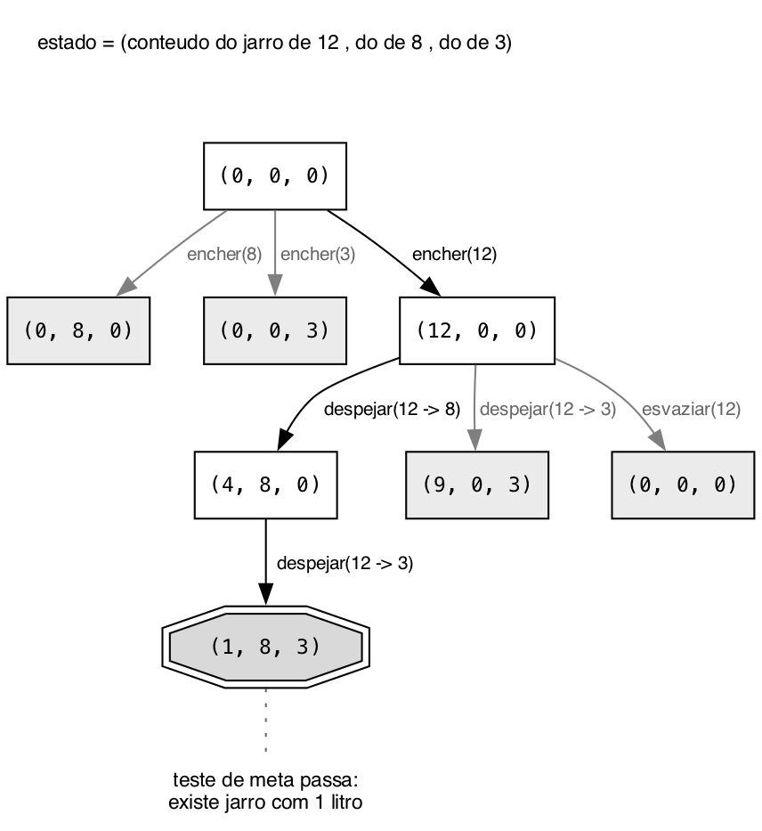
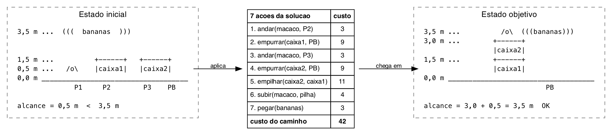

# Questão 3

Modelei os três problemas com os quatro blocos que o enunciado pede: estado inicial, função de teste, função-sucessor e função de custo. Escrevi a função-sucessor em notação lógica e a função de custo como um número por operação primitiva, e não "1 por ação", porque o custo de uma ação é a soma das operações que ela dispara.

Para o tempo e a memória usei o modelo da aula: 10.000 nós gerados por segundo e 1 KB por nó.

## a) Colorir um mapa plano com 4 cores

Antes de modelar, o mapa vira grafo: cada região é um vértice e cada fronteira entre duas regiões é uma aresta. É essa tradução que deixa a restrição "duas adjacentes não podem ter a mesma cor" virar uma checagem de vizinhos.



```
Estado inicial  = mapa sem nenhuma região pintada, (A, B, C, D, E) = (-, -, -, -, -)

Função de teste = ∀ espaço(x) cor(x) ≠ vazio
                  e ∄ espaço_adjacente(z, x) com cor(z) = cor(x)

Função-sucessor = ∀ espaço(x) com cor(x) = vazio, escolher cor_aleatória(y) e pintar_espaço(x, y)
                  e se ∃ espaço_adjacente(z, x) com cor(z) = y
                  então escolher cor_aleatória(w) e pintar_espaço(x, w)

Função de custo = escolher cor_aleatória() = 4
                  pintar_espaço()          = 2
                  espaço_adjacente()       = 1
                  espaço()                 = 1
```

Um estado é uma atribuição parcial: uma cor de 1 a 4, ou "sem cor", para cada região. Cada nível da árvore pinta uma região, na ordem A, B, C, D, E.



**Quando o algoritmo acha a solução.** Toda solução está exatamente na profundidade 5, porque são 5 regiões e cada nível pinta uma. Isso muda a escolha do algoritmo: como nenhuma solução é mais barata que outra, otimalidade não importa aqui e a busca em profundidade é a certa, já que ela desce até a profundidade 5 rápido e gasta memória linear.

O truque que faz esse problema ser viável é colocar a restrição dentro da própria função-sucessor: em vez de gerar as 4 cores e testar depois, eu já não gero a cor que conflita (o nó tracejado da figura). Isso poda o ramo antes dele nascer.

**Custo do caminho da solução.** Pintar uma região com k vizinhos custa `espaço() + cor_aleatória() + pintar_espaço() + k × espaço_adjacente()`, ou seja `7 + k`. Com os graus A=2, B=3, C=3, D=2 e E=2, o caminho (1, 2, 3, 1, 2) custa 9 + 10 + 10 + 9 + 9 = **47**.

**Tempo e memória.** Sem poda, b = 4 e d = 5, então são cerca de 1.365 nós gerados: 0,14 segundo e 1,3 MB. Com a poda dentro da sucessora, na prática fica bem abaixo disso.

## b) Três jarros de 12, 8 e 3 litros, medir 1 litro

```
Estado inicial  = (0, 0, 0)     -- jarros de 12, 8 e 3 litros, todos vazios

Função de teste = ∃ jarro(x) com conteúdo(x) = 1

Função-sucessor = ∀ jarro(x) se conteúdo(x) < capacidade(x) então encher(x)
                  e ∀ jarro(x) se conteúdo(x) > 0 então esvaziar(x)
                  e ∀ jarro(x) ∀ jarro(y) com x ≠ y,
                    se conteúdo(x) > 0 e conteúdo(y) < capacidade(y)
                    então despejar(x, y) com volume = min(conteúdo(x), capacidade(y) − conteúdo(y))

Função de custo = despejar()   = 3
                  encher()     = 2
                  esvaziar()   = 2
                  conteúdo()   = 1
                  capacidade() = 1
                  min()        = 1
                  jarro()      = 1
```

O estado é a tripla com quantos litros tem em cada jarro. Repara que a capacidade não entra no estado: ela é fixa, é propriedade do problema e não do mundo naquele instante.



**Quando o algoritmo acha a solução.** No instante em que gera um estado com algum componente igual a 1. A menor sequência tem 3 ações: encher o de 12, despejar no de 8 (sobram 4) e despejar no de 3 (sobra 1). Como as ações não custam todas o mesmo, aqui otimalidade importa, e a busca em largura garante o menor **número de ações**, não o menor custo.

**Custo do caminho da solução.** `encher(12)` = 1 + 1 + 2 = 4, `despejar(12 → 8)` = 2 + 2 + 1 + 1 + 3 = 9, `despejar(12 → 3)` = 9. Total **22**.

**O cuidado com estado repetido.** Na figura, `esvaziar(12)` devolve (0, 0, 0), que é o estado inicial. O espaço de estados é um grafo, não uma árvore, e sem lista de visitados a busca em profundidade fica rodando em círculo para sempre. Aqui isso é barato de resolver, porque o espaço inteiro tem no máximo 13 × 9 × 4 = 468 estados e cabe todo na memória.

**Tempo e memória.** b vale no máximo 12 (3 encher + 3 esvaziar + 6 despejos) e d = 3. Pela fórmula da largura, O(b^(d+1)), seriam até 12 + 144 + 1.728 + 20.736 = 22.620 nós, ou 2,3 segundos e 22 MB. Mas com o controle de estado repetido ela nunca passa dos 468 estados que existem, então na prática fica em no máximo 0,05 segundo e 468 KB.

## c) O macaco e as bananas

Assumi que o alcance do macaco é a própria altura dele, 0,5 m. Com um caixote só ele chega a 1,5 + 0,5 = 2,0 m, menos que os 3,5 m das bananas. Com os dois empilhados chega a 3,0 + 0,5 = 3,5 m, exatamente a altura da fruta. Ou seja, empilhar os dois caixotes embaixo das bananas não é uma opção entre outras, é a única solução, e isso já estava escondido nos números do enunciado.

Dividi o chão da jaula em lugares discretos: P1 (onde o macaco começa), P2 e P3 (onde estão os caixotes) e PB (embaixo das bananas).



```
Estado inicial  = (P1, P2, P3, empilhados = não, sobre = chão, bananas = não)
                  (posição do macaco, do caixote 1, do caixote 2, se estão empilhados,
                   sobre o que o macaco está, se já pegou as bananas)

Função de teste = bananas(macaco) = sim
                  isto é, altura_alcance(macaco) ≥ altura(bananas) e posição(macaco) = posição(bananas)
                  com altura_alcance(macaco) = 0,5 + altura da pilha sob ele

Função-sucessor = ∀ lugar(x) se sobre(macaco) = chão então andar(macaco, x)
                  e ∀ caixote(c) ∀ lugar(x)
                    se posição(macaco) = posição(c) e sobre(macaco) = chão
                    então empurrar(c, x)
                  e ∀ caixote(c1) ∀ caixote(c2) com c1 ≠ c2
                    se posição(c1) = posição(c2) e sobre(macaco) = chão
                    então empilhar(c2, c1)
                  e ∃ caixote(c) se posição(macaco) = posição(c) e sobre(macaco) = chão
                    então subir(macaco, c)
                  e se altura_alcance(macaco) ≥ altura(bananas) e posição(macaco) = posição(bananas)
                    então pegar(bananas)

Função de custo = empilhar()  = 8
                  empurrar()  = 6
                  subir()     = 3
                  andar()     = 2
                  pegar()     = 1
                  posição()   = 1
                  caixote()   = 1
                  lugar()     = 1
                  altura()    = 1
```

Os números do custo não são todos iguais de propósito: andar é barato, empurrar caixote arrasta peso, e empilhar é o mais caro porque levanta o caixote. Isso dá sentido a procurar o caminho mais barato, em vez de qualquer caminho.

**Quando o algoritmo acha a solução.** Na profundidade 7, com o caminho da figura: andar até o caixote 1, empurrar até PB, andar até o caixote 2, empurrar até PB, empilhar, subir e pegar. Custo do caminho: 3 + 9 + 3 + 9 + 11 + 4 + 3 = **42**.

Repara que as pré-condições dentro da sucessora fazem quase todo o trabalho de poda: com o macaco em cima de um caixote, nada além de pegar é gerado, e enquanto os caixotes estiverem em lugares diferentes, `empilhar` nem existe como ação.

**Tempo e memória.** Aqui a conta assusta. Com b em torno de 8 e d = 7, pela fórmula da largura, O(b^(d+1)), são cerca de 19 milhões de nós: 32 minutos e 19 GB. É o caso em que a profundidade limitada compensa, porque a solução tem tamanho conhecido e a memória cai de 19 GB para o ramo atual e os irmãos dele, algumas dezenas de nós.

## Resumo de como cheguei na solução

Segui o mesmo roteiro nos três: primeiro decidir o que é o estado, e só depois escrever o resto. Essa ordem importa, porque o estado é que determina tudo o que vem em seguida. Em (a) o estado é o mapa inteiro com as cores parciais, e não "a região que estou pintando", senão a sucessora não teria como enxergar os vizinhos já pintados para saber se a cor é válida. Em (b) é a tripla de conteúdos, sem as capacidades, que são fixas. Em (c) precisei juntar posição do macaco, posição dos dois caixotes, se estão empilhados e sobre o que o macaco está, porque tirar qualquer um desses campos deixaria a função de teste sem como calcular a altura de alcance.

O segundo passo foi escrever a função-sucessor como regra lógica e não como lista de ações. Fazendo assim apareceu o padrão que se repete nos três: as restrições do problema moram dentro da sucessora, na forma de pré-condição. É ela que decide o que nasce e o que nem chega a nascer, e por isso é ela que poda a árvore, não o teste de meta. Em (a) é a cor do vizinho, em (b) é jarro vazio e jarro cheio, em (c) é o macaco estar no chão e no mesmo lugar do caixote.

O terceiro passo foi o custo. Em vez de "1 por ação", quebrei cada ação nas operações primitivas que ela dispara e dei um preço a cada uma. Isso separa os três problemas: em (a) todas as soluções custam quase o mesmo e otimalidade não importa, em (b) as ações têm custos bem diferentes, e em (c) a diferença entre andar e empilhar é o que dá sentido a procurar o caminho mais barato.

Por último apliquei o modelo de tempo e memória da aula nos três, e é aí que dá para ver por que a escolha do algoritmo muda de problema para problema: (a) e (b) cabem em poucos megabytes e em poucos segundos, enquanto (c) passa de 19 GB na busca em largura e pede profundidade limitada.
