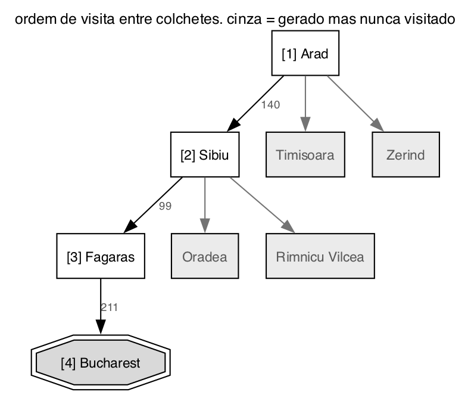
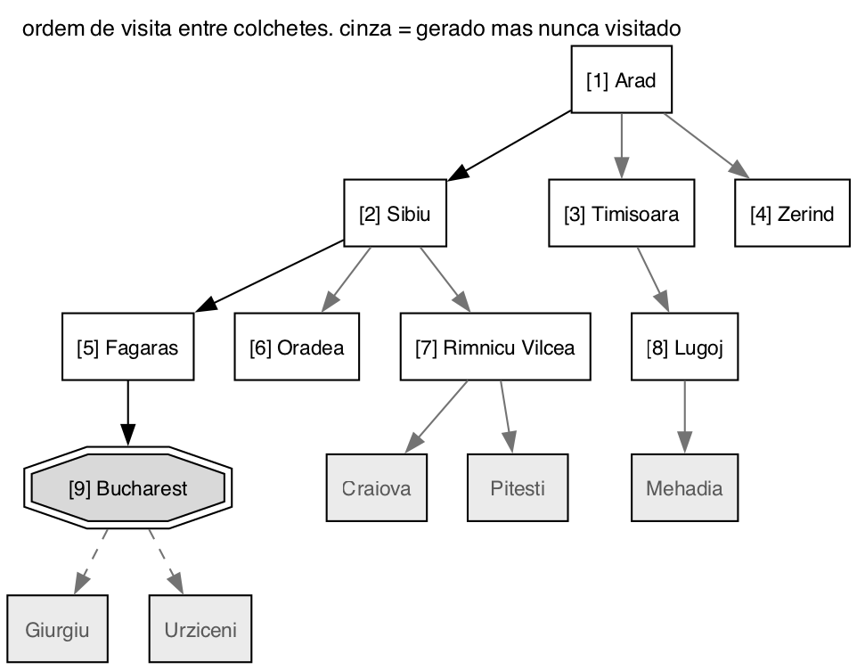
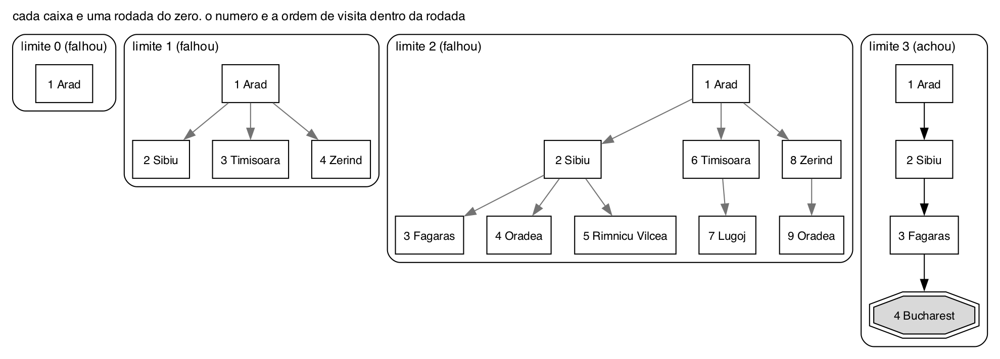

# Questão 5

Para as três simulações usei o mapa da Romênia da aula, saindo de Arad e chegando em Bucareste. Os vizinhos de cada cidade entram na fronteira em **ordem alfabética**, porque sem fixar uma ordem cada pessoa chegaria numa simulação diferente.

Também evitei estado repetido: uma cidade que já está na memória não entra de novo na fronteira. Sem isso, Arad gera Sibiu, Sibiu gera Arad de novo, e a busca fica andando em círculo.

Para tempo e memória usei o modelo da aula: 10.000 nós gerados por segundo e 1 KB por nó.

## a) Busca em profundidade

**Qual nó é visitado primeiro:** o mais fundo da fronteira, que é sempre o último que entrou.

**Como a fronteira se comporta:** é uma pilha. Ela cresce enquanto a busca desce por um ramo e, quando um ramo termina sem achar a meta, os nós dele são apagados da memória. Por isso ela guarda só o caminho atual e os irmãos que ainda não foram visitados.

**Desempenho:** tempo O(b^m) e espaço O(b·m). O espaço linear é a grande vantagem dela. Em troca ela não é completa, porque pode descer num ramo infinito ou num ciclo e nunca voltar, e não é ótima, porque devolve a primeira solução que aparecer no ramo em que entrou.

**Simulação.** A coluna "fronteira" mostra a pilha depois de cada passo, com o topo à esquerda.

| Passo | Visitado | Filhos conhecidos (expansão) | Fronteira |
|:--:|:--|:--|:--|
| 1 | Arad | Sibiu, Timisoara, Zerind | Sibiu, Timisoara, Zerind |
| 2 | Sibiu | Fagaras, Oradea, Rimnicu Vilcea | Fagaras, Oradea, Rimnicu Vilcea, Timisoara, Zerind |
| 3 | Fagaras | Bucharest | Bucharest, Oradea, Rimnicu Vilcea, Timisoara, Zerind |
| 4 | Bucharest | é a meta, para | Oradea, Rimnicu Vilcea, Timisoara, Zerind |

- **4 nós visitados e 3 expandidos.** Bucareste é visitada mas não é expandida, porque a profundidade testa a meta antes de expandir.
- **Caminho:** Arad, Sibiu, Fagaras, Bucareste, com 140 + 99 + 211 = **450 km**.
- **Tempo e memória:** gerou 8 nós, então 0,8 milissegundo. A memória é o maior tamanho que a pilha chegou, igual contei na questão 1: 5 nós, 5 KB.

Aqui ela teve sorte. O primeiro vizinho em ordem alfabética foi o certo três vezes seguidas.

## b) Busca em extensão (ou largura)

**Qual nó é visitado primeiro:** o mais raso da fronteira. Entre dois nós do mesmo nível, sai o que entrou primeiro.

**Como a fronteira se comporta:** é uma fila. Ela termina um nível inteiro antes de descer para o próximo, então guarda todos os nós do nível de uma vez e cresce muito rápido.

**Desempenho:** tempo e espaço O(b^(d+1)). O +1 vem do fato de que a largura visita, expande e só depois testa se é a meta, então mesmo achando a solução na profundidade d ela ainda gera os filhos dela. É completa se b for finito e ótima se todas as ações tiverem o mesmo custo. O problema é a memória: na tabela da aula, com b = 10 e d = 12, ela precisaria de 10 petabytes.

**Simulação.** A coluna "fronteira" mostra a fila depois de cada passo, com o primeiro da fila à esquerda.

| Passo | Visitado | Filhos conhecidos (expansão) | Fronteira |
|:--:|:--|:--|:--|
| 1 | Arad | Sibiu, Timisoara, Zerind | Sibiu, Timisoara, Zerind |
| 2 | Sibiu | Fagaras, Oradea, Rimnicu Vilcea | Timisoara, Zerind, Fagaras, Oradea, Rimnicu Vilcea |
| 3 | Timisoara | Lugoj | Zerind, Fagaras, Oradea, Rimnicu Vilcea, Lugoj |
| 4 | Zerind | nenhum novo (Arad e Oradea já conhecidos) | Fagaras, Oradea, Rimnicu Vilcea, Lugoj |
| 5 | Fagaras | Bucharest | Oradea, Rimnicu Vilcea, Lugoj, Bucharest |
| 6 | Oradea | nenhum novo | Rimnicu Vilcea, Lugoj, Bucharest |
| 7 | Rimnicu Vilcea | Craiova, Pitesti | Lugoj, Bucharest, Craiova, Pitesti |
| 8 | Lugoj | Mehadia | Bucharest, Craiova, Pitesti, Mehadia |
| 9 | Bucharest | Giurgiu, Urziceni, depois testa: é a meta | Craiova, Pitesti, Mehadia, Giurgiu, Urziceni |

- **9 nós visitados e 9 expandidos.** Aqui até Bucareste é expandida, por causa da ordem visita, expande e testa.
- **Caminho:** o mesmo, Arad, Sibiu, Fagaras, Bucareste, **450 km**.
- **Tempo e memória:** gerou 14 nós, então 1,4 milissegundo e 14 KB, porque a largura guarda tudo o que gerou.

Uma coisa que eu só percebi conferindo os quilômetros no final: **450 km não é a menor rota**. Arad, Sibiu, Rimnicu Vilcea, Pitesti, Bucareste dá 140 + 80 + 97 + 101 = **418 km**. Ela tem 4 trechos em vez de 3, então a largura nunca acha ela primeiro. A largura é ótima em número de ações, não em quilômetros. Como no mapa da Romênia os trechos têm tamanhos diferentes, a condição de otimalidade dela não vale aqui. Para achar os 418 km seria preciso a busca de custo uniforme.

## c) Busca em profundidade iterativa

**Qual nó é visitado primeiro:** o mesmo da profundidade, o mais fundo. A diferença é que existe um limite de profundidade, e a busca é refeita do zero com limite 0, 1, 2, 3... até achar a solução.

**Como a fronteira se comporta:** é uma pilha, igual à da profundidade, só que **apagada no fim de cada rodada**. Nós que estão no limite não têm filhos gerados.

**Desempenho:** tempo O(b^d) e espaço O(b·d). Ela pega a memória pequena da profundidade e a completude da largura, porque testa as profundidades em ordem e acha primeiro a solução mais rasa. É ótima se cada passo custar 1. Refazer as rodadas parece desperdício, mas no exemplo do slide (b = 10, d = 5) ela gera 123.456 nós contra 1.111.100 da largura.

**Simulação.** Aqui não usei a lista de estados já conhecidos, só não deixo a busca voltar para uma cidade que já está no caminho atual. Com a lista, uma cidade alcançada primeiro por um caminho mais longo ficaria bloqueada para um caminho mais curto, e com o limite isso pode impedir a busca de chegar na meta.

| Limite | Ordem de visita | Visitados | Resultado |
|:--:|:--|:--:|:--|
| 0 | Arad | 1 | não achou |
| 1 | Arad, Sibiu, Timisoara, Zerind | 4 | não achou |
| 2 | Arad, Sibiu, Fagaras, Oradea, Rimnicu Vilcea, Timisoara, Lugoj, Zerind, Oradea | 9 | não achou |
| 3 | Arad, Sibiu, Fagaras, Bucharest | 4 | **achou** |

- **18 nós visitados e 8 expandidos somando as quatro rodadas.** Quem está no limite da rodada é visitado mas não expandido. Na rodada do limite 2 Oradea aparece duas vezes, uma por Sibiu e outra por Zerind, porque são dois caminhos diferentes até ela.
- **Caminho:** Arad, Sibiu, Fagaras, Bucareste, **450 km**, profundidade 3.
- **Tempo e memória:** gerou 1 + 4 + 9 + 8 = 22 nós, então 2,2 milissegundos. A pilha nunca passou de 5 nós ao mesmo tempo, 5 KB, porque a cada rodada e a cada ramo que termina ela apaga o que não serve mais.

## Comparando as três

| Estratégia | Visitados | Expandidos | Nós gerados | Tempo | Memória | Caminho |
|:--|:--:|:--:|:--:|:--:|:--:|:--|
| Profundidade | 4 | 3 | 8 | 0,8 ms | 5 KB | 450 km |
| Largura | 9 | 9 | 14 | 1,4 ms | 14 KB | 450 km |
| Profundidade iterativa | 18 | 8 | 22 | 2,2 ms | 5 KB | 450 km |

## Resumo de como cheguei na solução

Para explicar as três estratégias segui a ordem que a questão pede: qual nó sai primeiro, como a fronteira se comporta e o desempenho. Percebi que o primeiro item define os outros dois. Se sai o mais fundo, a fronteira é uma pilha e a memória fica pequena. Se sai o mais raso, a fronteira é uma fila e a memória cresce com o nível inteiro.

Para as simulações passei o mapa da Romênia para uma lista de vizinhos de cada cidade, em ordem alfabética, e fiz uma tabela por algoritmo com uma linha por passo, anotando quem foi visitado, quem ele expandiu e como a fronteira ficou. Depois rodei o mesmo mapa no código da questão 9 para conferir se a ordem de visita batia com a que eu fiz à mão, e bateu. Na contagem de expandidos usei a definição que o professor deu na aula, de que expandir é visitar um nó e conhecer os filhos dele. Por isso a largura expande até Bucareste e a profundidade não.

A parte que mais me chamou atenção foi descobrir que os três algoritmos devolveram 450 km, sendo que existe uma rota de 418 km. Isso me fez entender na prática que a otimalidade da largura e da profundidade iterativa é sobre a quantidade de trechos, e não sobre a distância, e que isso só coincide quando todos os trechos custam o mesmo.
