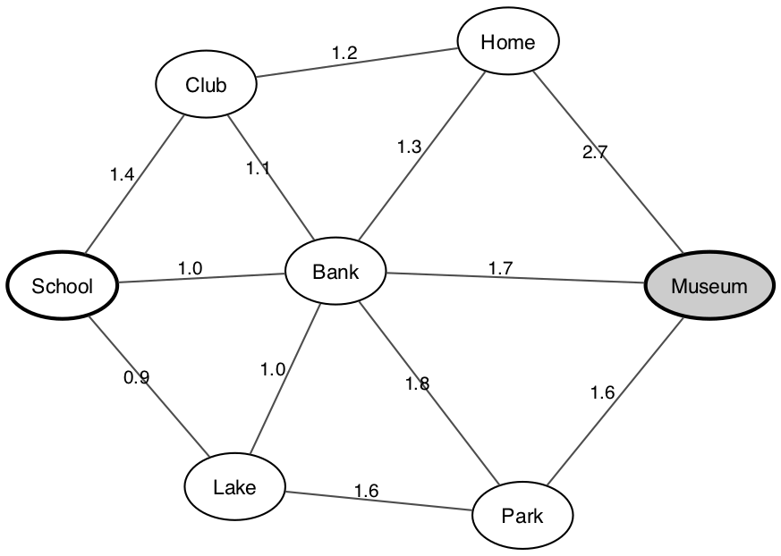
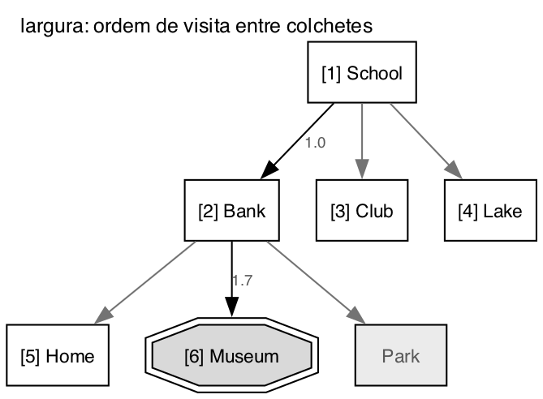
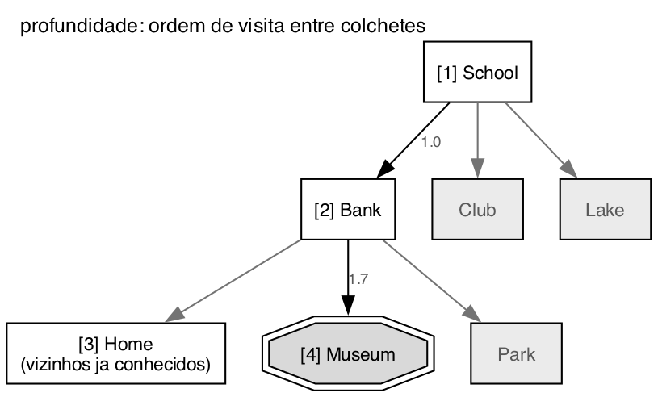

# Questão 7

Antes de simular passei o mapa para um grafo, com cada lugar sendo um nó e cada rua uma aresta com a distância em km. As ruas valem nos dois sentidos.

Lista de vizinhos de cada lugar, em ordem alfabética, que é a ordem em que eles entram na fronteira:

| Lugar | Vizinhos |
|:--|:--|
| School | Bank (1,0), Club (1,4), Lake (0,9) |
| Bank | Club (1,1), Home (1,3), Lake (1,0), Museum (1,7), Park (1,8), School (1,0) |
| Club | Bank (1,1), Home (1,2), School (1,4) |
| Home | Bank (1,3), Club (1,2), Museum (2,7) |
| Lake | Bank (1,0), Park (1,6), School (0,9) |
| Museum | Bank (1,7), Home (2,7), Park (1,6) |
| Park | Bank (1,8), Lake (1,6), Museum (1,6) |

Nas buscas em largura e em profundidade um lugar que já está na memória não entra de novo na fronteira, senão a busca fica andando em círculo entre School, Bank e Lake. Para o tempo e a memória usei o modelo da aula, 10.000 nós gerados por segundo e 1 KB por nó.

## a) Busca em largura

| Passo | Visitado | Filhos conhecidos (expansão) | Fronteira (fila) |
|:--:|:--|:--|:--|
| 1 | School | Bank, Club, Lake | Bank, Club, Lake |
| 2 | Bank | Home, Museum, Park | Club, Lake, Home, Museum, Park |
| 3 | Club | nenhum novo | Lake, Home, Museum, Park |
| 4 | Lake | nenhum novo | Home, Museum, Park |
| 5 | Home | nenhum novo | Museum, Park |
| 6 | Museum | nenhum novo, depois testa: é a meta | Park |

- **6 nós visitados e 6 expandidos.**
- **Caminho:** School, Bank, Museum, 2 trechos, 1,0 + 1,7 = **2,7 km**.
- **Tempo e memória:** gerou os 7 lugares do mapa, então 0,7 milissegundo e 7 KB.

Ela já tinha gerado Museum no passo 2, mas como Club, Lake e Home estavam na frente da fila, teve que visitar os três antes, mesmo nenhum deles levando a lugar nenhum.

## b) Busca em profundidade

| Passo | Visitado | Filhos conhecidos (expansão) | Fronteira (pilha, topo à esquerda) |
|:--:|:--|:--|:--|
| 1 | School | Bank, Club, Lake | Bank, Club, Lake |
| 2 | Bank | Home, Museum, Park | Home, Museum, Park, Club, Lake |
| 3 | Home | nenhum novo (Bank, Club e Museum já conhecidos) | Museum, Park, Club, Lake |
| 4 | Museum | é a meta, para | Park, Club, Lake |

- **4 nós visitados e 3 expandidos.** Home foi expandido, mas todos os vizinhos dele já estavam na memória, então ele virou um beco sem saída e a busca voltou para o próximo da pilha, que era Museum.
- **Caminho:** School, Bank, Museum, **2,7 km**.
- **Tempo e memória:** também gerou 7 nós, então 0,7 milissegundo. A pilha chegou no máximo a 5 nós, 5 KB.

## c) Profundidade iterativa (com limite de 4)

Aqui não usei a lista de lugares conhecidos, só não deixo a busca voltar para um lugar que já está no caminho atual. O limite conta trechos: limite 0 é só School, limite 1 deixa ir até os vizinhos de School e assim por diante.

| Limite | Ordem de visita | Visitados | Resultado |
|:--:|:--|:--:|:--|
| 0 | School | 1 | não achou |
| 1 | School, Bank, Club, Lake | 4 | não achou |
| 2 | School, Bank, Club, Home, Lake, Museum | 6 | **achou** |

- **11 nós visitados somando as três rodadas.**
- **Caminho:** School, Bank, Museum, **2,7 km**.
- **Tempo e memória:** gerou 1 + 4 + 9 = 14 nós, então 1,4 milissegundo. A pilha chegou no máximo a 7 nós ao mesmo tempo, 7 KB, na rodada do limite 2, logo depois de expandir Bank.

Ela nem chegou a usar o limite 4. Como Museum está a 2 trechos de School, a rodada do limite 2 já encontra, e os limites 3 e 4 nunca são testados.

## Qual dos algoritmos apresentou melhor resultado?

| Algoritmo | Visitados | Nós gerados | Tempo | Memória | Caminho | Custo |
|:--|:--:|:--:|:--:|:--:|:--|:--:|
| Largura | 6 | 7 | 0,7 ms | 7 KB | School, Bank, Museum | 2,7 km |
| Profundidade | **4** | 7 | 0,7 ms | 5 KB | School, Bank, Museum | 2,7 km |
| Profundidade iterativa | 11 | 14 | 1,4 ms | 7 KB | School, Bank, Museum | 2,7 km |

Os três acharam **o mesmo caminho**, e conferindo as outras rotas ele é também o mais curto em km. Os outros caminhos até Museum são School, Lake, Park, Museum com 4,1 km, School, Bank, Park, Museum com 4,4 km e School, Club, Home, Museum com 5,3 km.

Então a diferença entre eles ficou só no esforço. **A busca em profundidade foi a melhor neste mapa**, porque visitou só 4 nós contra 6 da largura e 11 da iterativa. Mas acho importante dizer que isso foi por causa do mapa e da ordem alfabética, e não porque a profundidade seja melhor em geral. Bank é o primeiro vizinho de School e é vizinho direto de Museum, então ela desceu quase direto na resposta. Se Museum estivesse num ramo que ela explora por último, a conta seria outra.

A profundidade iterativa foi a que mais trabalhou, por refazer as rodadas, mas é a única das três que junta as duas garantias: acha o caminho com menos trechos, como a largura, e gasta pouca memória, como a profundidade.

## Resumo de como cheguei na solução

O primeiro passo foi transformar o desenho do mapa numa tabela de vizinhos, colocando cada rua nos dois lugares que ela liga, e decidir uma ordem para os vizinhos. Escolhi a alfabética, igual nas outras questões, porque sem uma ordem fixa a busca em profundidade não tem uma resposta só.

Depois simulei os três algoritmos à mão, com uma tabela por algoritmo mostrando quem foi visitado, quem ele expandiu e como a fronteira ficou. Nesse momento percebi que os três algoritmos não usam os quilômetros para nada, porque são buscas cegas. Usei as distâncias só no final, para calcular o custo do caminho que cada um devolveu e conferir se era o mais curto. Para ter certeza da simulação da largura e da profundidade, rodei o código da questão 8, que usa esse mesmo mapa, e a ordem de visita foi a mesma que eu tinha feito à mão.

Para responder qual foi o melhor, como os três acharam o mesmo caminho, comparei pelo número de nós visitados e pelo tempo e memória do modelo da aula. Achei importante deixar claro que a vitória da profundidade depende do formato deste mapa, porque na questão 1 eu já tinha visto o contrário: para achar o nó 10, que estava no último ramo, a profundidade visitou 17 nós e a largura só 10.
