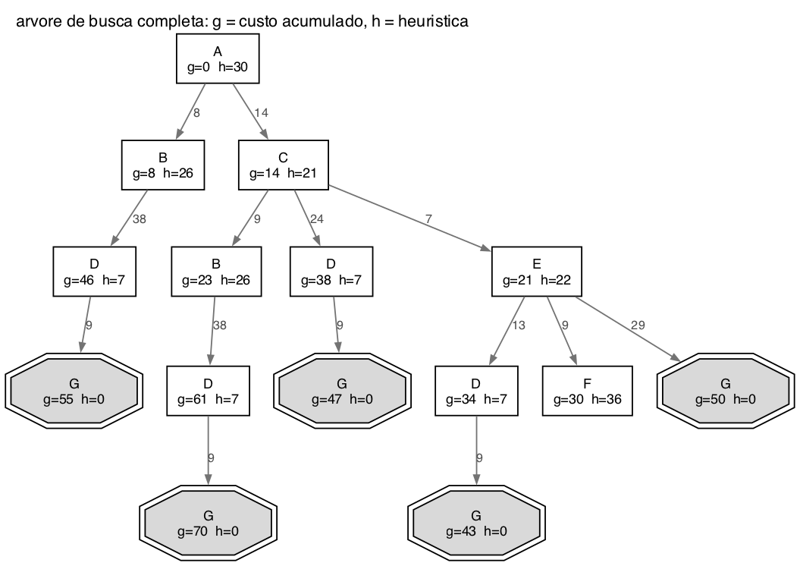
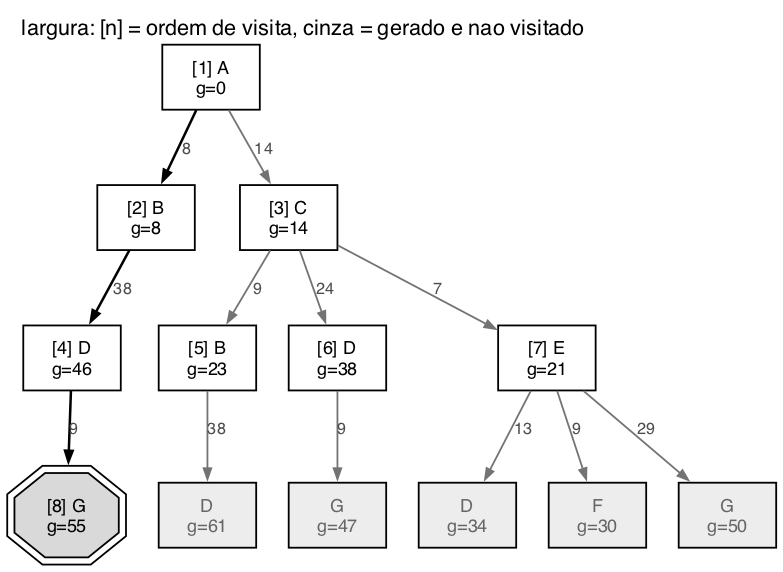
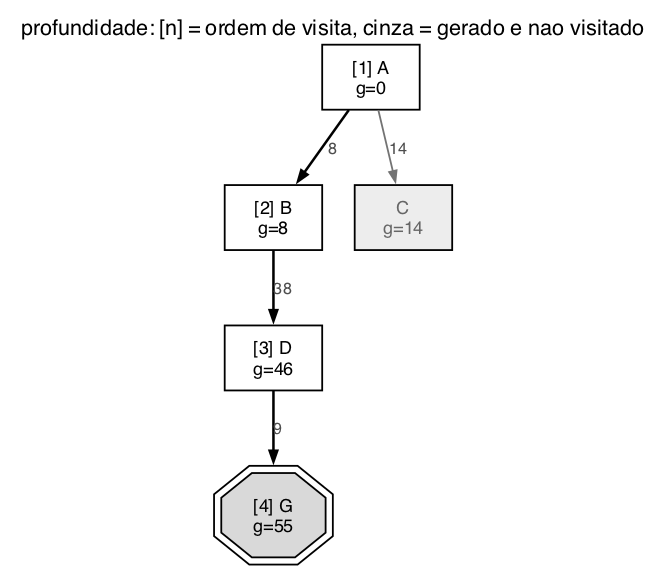
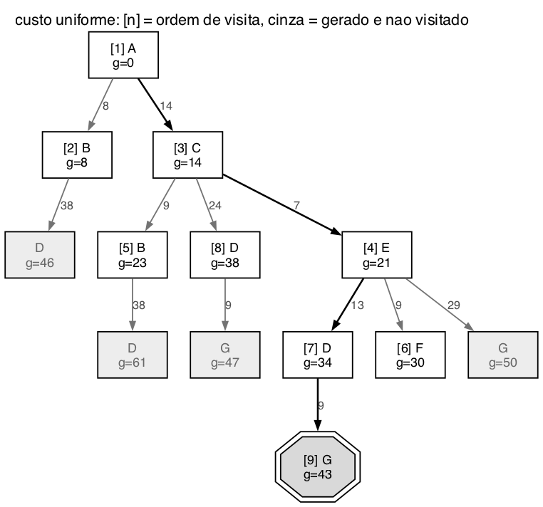
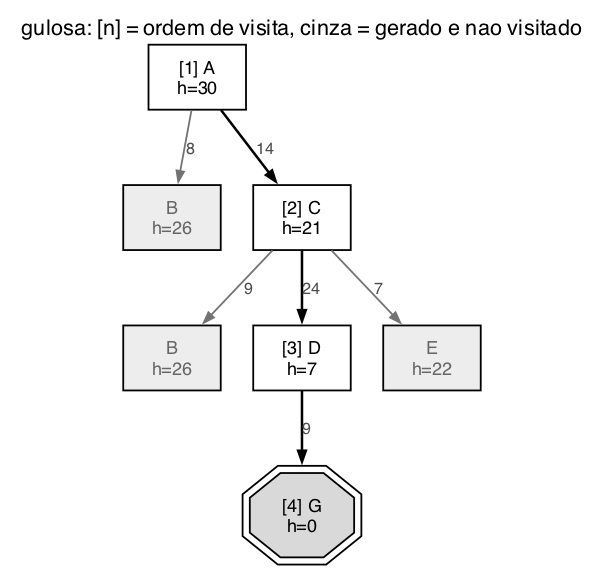
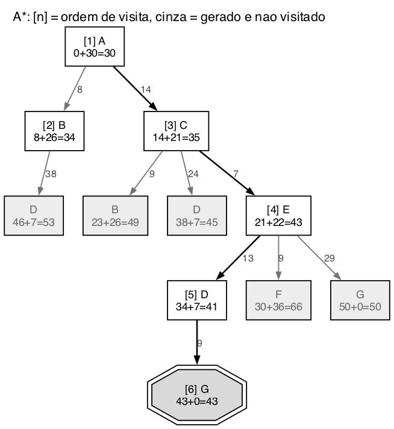

# Questão 1

Antes de tudo passei o grafo para uma lista de sucessores. Como o grafo é dirigido, cada arco só vale no sentido da seta. Os sucessores estão em ordem alfabética, que é a ordem pedida no enunciado.

| Nó | h(n) | Sucessores (custo do arco) |
|:--:|:--:|:--|
| A | 30 | B (8), C (14) |
| B | 26 | D (38) |
| C | 21 | B (9), D (24), E (7) |
| D | 7 | G (9) |
| E | 22 | D (13), F (9), G (29) |
| F | 36 | nenhum |
| G | 0 | nenhum (objetivo) |

## A) Árvore de busca

Como não existe ciclo no grafo, a árvore termina. Em cada nó coloquei o g, que é o custo acumulado desde A, e o h, que é a heurística do próprio nó.

Repara que o mesmo estado aparece várias vezes na árvore. D aparece quatro vezes, por exemplo, porque dá para chegar nele por B, por C, por C e B, e por C e E, cada um com um custo diferente.

## B) Caminho ótimo

Listei todos os caminhos de A até G que aparecem na árvore e somei os custos:

| Caminho | Custo |
|:--|:--:|
| A, B, D, G | 8 + 38 + 9 = 55 |
| A, C, B, D, G | 14 + 9 + 38 + 9 = 70 |
| A, C, D, G | 14 + 24 + 9 = 47 |
| **A, C, E, D, G** | **14 + 7 + 13 + 9 = 43** |
| A, C, E, G | 14 + 7 + 29 = 50 |

O caminho ótimo é **A, C, E, D, G, com custo 43**.

## C) Nós expandidos em cada estratégia

Usei as mesmas convenções da Lista 1: visitar é tirar o nó da fronteira para olhar o estado, e expandir é gerar os filhos dele. Nas buscas que usam valor (custo uniforme, gulosa e A*), o teste de meta é feito quando o nó sai da fronteira, igual o professor fez no exemplo da Romênia na aula. Por isso o G só conta quando é escolhido, e não quando aparece pela primeira vez na fronteira. Empates seriam resolvidos pelo nó mais à esquerda, mas nesse grafo não aconteceu nenhum.

### a) Busca em largura

- **Ordem de expansão:** A, B, C, D, B, D, E, G
- **Caminho encontrado:** A, B, D, G, custo **55**

A largura não olha custo nenhum, só o nível. O primeiro G que aparece no nível 3 é o que vem por B, que está mais à esquerda, então ela devolve o caminho mais caro de três trechos.

### b) Busca em profundidade

- **Ordem de expansão:** A, B, D, e o G é visitado logo depois
- **Caminho encontrado:** A, B, D, G, custo **55**

Ela desceu pelo ramo mais à esquerda e caiu direto no G. Foi a que menos trabalhou, mas devolveu o mesmo caminho ruim da largura.

### c) Busca de custo uniforme

| Passo | Sai da fronteira (g) | Fronteira depois do passo |
|:--:|:--|:--|
| 1 | A (0) | B 8, C 14 |
| 2 | B (8) | C 14, D 46 |
| 3 | C (14) | D 46, B 23, D 38, E 21 |
| 4 | E (21) | D 46, B 23, D 38, D 34, F 30, G 50 |
| 5 | B (23) | D 46, D 38, D 34, F 30, G 50, D 61 |
| 6 | F (30) | D 46, D 38, D 34, G 50, D 61 |
| 7 | D (34) | D 46, D 38, G 50, D 61, G 43 |
| 8 | D (38) | D 46, G 50, D 61, G 43, G 47 |
| 9 | G (43) | é a meta |

- **Ordem de expansão:** A, B, C, E, B, F, D, D, e o G sai no passo 9
- **Caminho encontrado:** A, C, E, D, G, custo **43**, que é o ótimo

No passo 4 já existia um G na fronteira com custo 50, mas como a busca só testa a meta quando o nó sai, ela continuou e achou o de 43.

### d) Busca gulosa

- **Ordem de expansão:** A, C, D, e o G é visitado logo depois
- **Caminho encontrado:** A, C, D, G, custo **47**

A gulosa escolheu C porque h(C) = 21 é menor que h(B) = 26, e depois escolheu D porque h(D) = 7 é o menor da fronteira. Ela foi rápida, mas como não soma o custo do caminho, não percebeu que o arco C para D custa 24 e que dar a volta por E saía mais barato.

### e) A*

| Passo | Sai da fronteira (g + h = f) | Fronteira depois do passo |
|:--:|:--|:--|
| 1 | A (0 + 30 = 30) | B 34, C 35 |
| 2 | B (8 + 26 = 34) | C 35, D 53 |
| 3 | C (14 + 21 = 35) | D 53, B 49, D 45, E 43 |
| 4 | E (21 + 22 = 43) | D 53, B 49, D 45, D 41, F 66, G 50 |
| 5 | D (34 + 7 = 41) | D 53, B 49, D 45, F 66, G 50, G 43 |
| 6 | G (43 + 0 = 43) | é a meta |

- **Ordem de expansão:** A, B, C, E, D, e o G sai no passo 6
- **Caminho encontrado:** A, C, E, D, G, custo **43**, o ótimo

### Comparando

| Estratégia | Nós expandidos | Caminho | Custo |
|:--|:--:|:--|:--:|
| Largura | 8 | A, B, D, G | 55 |
| Profundidade | 3 | A, B, D, G | 55 |
| Custo uniforme | 8 | A, C, E, D, G | 43 |
| Gulosa | 3 | A, C, D, G | 47 |
| A* | 5 | A, C, E, D, G | 43 |

Só o custo uniforme e o A* acharam o ótimo, e o A* fez isso expandindo 5 nós em vez de 8.

## Resumo de como cheguei na solução

Primeiro transformei o desenho numa tabela de sucessores com os custos e as heurísticas, porque é muito fácil errar a direção de uma seta olhando só a figura. Com a tabela montei a árvore completa e, a partir dela, listei todos os caminhos até G para descobrir o ótimo antes de rodar qualquer algoritmo. Isso me deu um gabarito: quando um algoritmo devolvesse um caminho, eu já sabia se ele era o melhor ou não.

Depois simulei cada estratégia escrevendo a fronteira passo a passo. A parte que mais me ajudou a entender foi ver a diferença entre o custo uniforme e o A*: os dois acham o mesmo caminho, mas o A* vai direto para o lado certo da árvore porque o h puxa a busca para perto do G, enquanto o custo uniforme abre também B, F e um D que não levavam a nada. Também percebi que a gulosa e a profundidade gastaram o mesmo esforço, mas a gulosa achou um caminho melhor, só que ainda não o ótimo, porque ela ignora quanto já gastou.
