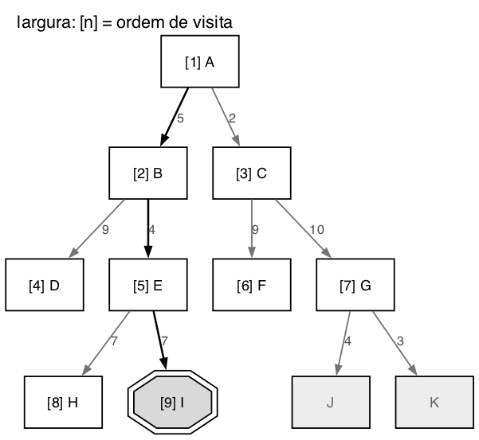
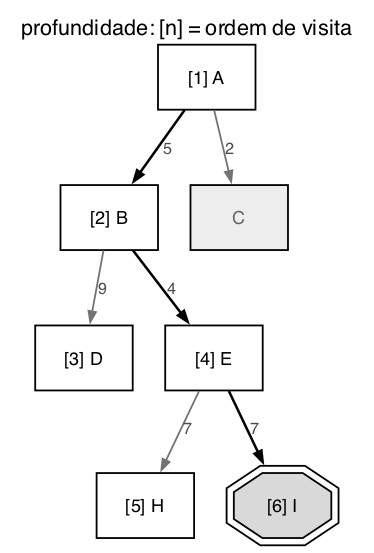
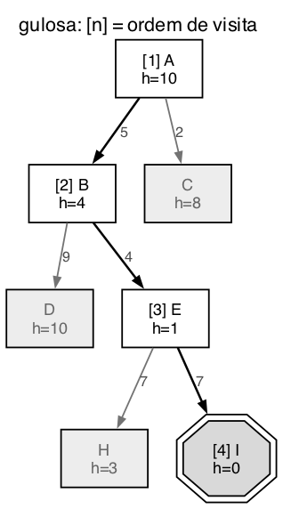
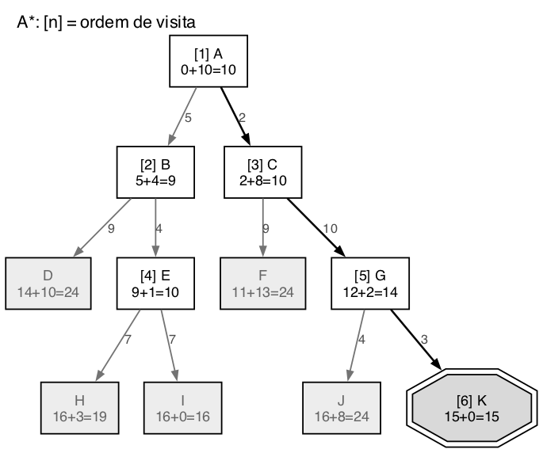

# Questão 6

O espaço de busca é uma árvore, então não tem estado repetido. Passei ela para uma tabela:

| Nó | h(n) | Filhos (custo) |
|:--:|:--:|:--|
| A | 10 | B (5), C (2) |
| B | 4 | D (9), E (4) |
| C | 8 | F (9), G (10) |
| D | 10 | nenhum |
| E | 1 | H (7), I (7) |
| F | 13 | nenhum |
| G | 2 | J (4), K (3) |
| H | 3 | nenhum |
| I | 0 | nenhum (objetivo) |
| J | 8 | nenhum |
| K | 0 | nenhum (objetivo) |

Existem duas metas: **I**, com custo A, B, E, I = 5 + 4 + 7 = 16, e **K**, com custo A, C, G, K = 2 + 10 + 3 = 15. Então a solução ótima é K.

Convenções que usei, as mesmas da questão 1: "examinar" um nó é tirar ele da fronteira e olhar o estado, e nas buscas com valor o teste de meta é feito nesse momento. Para os empates segui a regra do enunciado: primeiro o nó mais próximo da raiz e, se continuar empatado, o mais à esquerda.

## a) Busca em largura

**Nós examinados:** A, B, C, D, E, F, G, H, I

Ela abre a árvore nível por nível. I e K estão os dois na profundidade 3, mas I está mais à esquerda, então ela chega nele primeiro. Devolve **I, com custo 16**, que não é o ótimo.

## b) Busca em profundidade

**Nós examinados:** A, B, D, E, H, I

Ela desce sempre pelo filho mais à esquerda. D é folha e não é meta, então ela volta e vai para E, examina H, que também é folha, e depois I, que é meta. Devolve **I, com custo 16**.

## c) Busca gulosa

A gulosa escolhe sempre o nó da fronteira com o menor h(n).

| Passo | Examinado (h) | Fronteira depois (h) |
|:--:|:--|:--|
| 1 | A (10) | B 4, C 8 |
| 2 | B (4) | C 8, D 10, E 1 |
| 3 | E (1) | C 8, D 10, H 3, I 0 |
| 4 | I (0) | é meta |

**Nós examinados:** A, B, E, I

Ela foi direto para I, porque B tem h = 4, menor que o 8 de C, e depois E tem h = 1. Mas devolveu **I, com custo 16**. Como não soma o custo do caminho, nem chegou a olhar o lado de C, onde estava a meta mais barata.

## d) A*

O A* escolhe sempre o menor f(n) = g(n) + h(n).

| Passo | Examinado (g + h = f) | Fronteira depois (f) |
|:--:|:--|:--|
| 1 | A (0 + 10 = 10) | B 9, C 10 |
| 2 | B (5 + 4 = 9) | C 10, D 24, E 10 |
| 3 | C (2 + 8 = 10) | D 24, E 10, F 24, G 14 |
| 4 | E (9 + 1 = 10) | D 24, F 24, G 14, H 19, I 16 |
| 5 | G (12 + 2 = 14) | D 24, F 24, H 19, I 16, J 24, K 15 |
| 6 | K (15 + 0 = 15) | é meta |

**Nós examinados:** A, B, C, E, G, K

No passo 3 houve um empate: C e E com f = 10. Pela regra do enunciado ganha o mais próximo da raiz, e C está na profundidade 1 enquanto E está na 2, então C foi primeiro. No passo 5 a meta I já estava na fronteira com f = 16, mas G tinha f = 14, menor. O A* abriu G e encontrou K com 15. Devolve **K, com custo 15**, a solução ótima.

## Comparando

| Algoritmo | Nós examinados | Meta encontrada | Custo |
|:--|:--:|:--:|:--:|
| Largura | 9 | I | 16 |
| Profundidade | 6 | I | 16 |
| Gulosa | 4 | I | 16 |
| A* | 6 | K | **15** |

## Resumo de como cheguei na solução

Comecei calculando o custo das duas metas antes de simular qualquer coisa, para saber qual era a resposta certa. Isso foi importante, porque três dos quatro algoritmos devolveram I, e sem essa conta eu poderia achar que I era a resposta.

Depois simulei cada um mantendo a fronteira escrita a cada passo. Na largura e na profundidade só importa a posição do nó na árvore. Na gulosa e no A* tive que anotar o h e o f de cada nó. O ponto em que tive que tomar mais cuidado foi o empate entre C e E no A*: aí apliquei a regra do enunciado de preferir o nó mais perto da raiz. Se tivesse escolhido E, ele teria aberto I com f = 16 antes de G, mas o resultado final seria o mesmo, porque G com f = 14 ainda sairia antes de I.

O que mais me chamou atenção foi a gulosa: ela examinou só 4 nós, foi a mais rápida, mas devolveu a meta errada justamente por ignorar o g(n). O A* examinou 6 e foi o único a achar a ótima.
