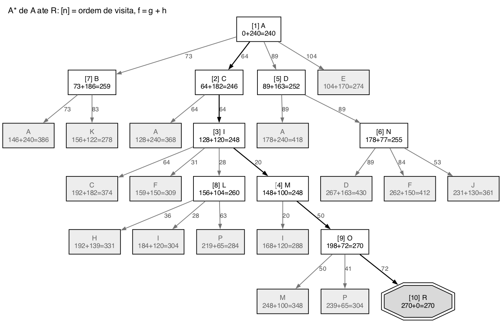

# Questão 15

Passei o mapa para uma lista de vizinhos. As estradas valem nos dois sentidos, e os vizinhos estão em ordem alfabética:

| Cidade | Vizinhos (km) | h(n) até R |
|:--:|:--|:--:|
| A | B 73, C 64, D 89, E 104 | 240 |
| B | A 73, K 83 | 186 |
| C | A 64, I 64 | 182 |
| D | A 89, N 89 | 163 |
| E | A 104, J 40 | 170 |
| F | I 31, N 84 | 150 |
| G | J 35, Q 113 | 165 |
| H | K 35, L 36 | 139 |
| I | C 64, F 31, L 28, M 20 | 120 |
| J | E 40, G 35, N 53, Q 80 | 130 |
| K | B 83, H 35 | 122 |
| L | H 36, I 28, P 63 | 104 |
| M | I 20, O 50 | 100 |
| N | D 89, F 84, J 53 | 77 |
| O | M 50, P 41, R 72 | 72 |
| P | L 63, O 41, R 65 | 65 |
| Q | G 113, J 80, R 65 | 65 |
| R | O 72, P 65, Q 65 | 0 |

Igual ao exemplo da Romênia da aula, o A* gera todos os vizinhos de cada cidade, inclusive a cidade de onde veio, e o teste de meta é feito quando a cidade sai da fronteira.

## a) Árvore de busca

Em cada nó está g + h = f. Os nós brancos foram expandidos, na ordem entre colchetes. Os cinzas foram gerados mas ficaram esperando na fronteira.

## b) Ordem de expansão

| Passo | Expandido (g + h = f) | Novos nós na fronteira (f) | Menor f da fronteira depois |
|:--:|:--|:--|:--|
| 1 | A (0 + 240 = 240) | B 259, C 246, D 252, E 274 | C 246 |
| 2 | C (64 + 182 = 246) | A 368, I 248 | I 248 |
| 3 | I (128 + 120 = 248) | C 374, F 309, L 260, M 248 | M 248 |
| 4 | M (148 + 100 = 248) | I 288, O 270 | D 252 |
| 5 | D (89 + 163 = 252) | A 418, N 255 | N 255 |
| 6 | N (178 + 77 = 255) | D 430, F 412, J 361 | B 259 |
| 7 | B (73 + 186 = 259) | A 386, K 278 | L 260 |
| 8 | L (156 + 104 = 260) | H 331, I 304, P 284 | O 270 |
| 9 | O (198 + 72 = 270) | M 348, P 304, R 270 | R 270 |
| 10 | R (270 + 0 = 270) | é a meta | |

**Ordem de expansão:** A, C, I, M, D, N, B, L, O. No passo 10 sai R, que é a meta.

Dois momentos mostram bem o backtracking que o professor explicou na aula:

- Depois de M (passo 4), o melhor nó deixou de estar no ramo de C. D, que estava parado na fronteira desde o passo 1 com f = 252, ficou menor que O (270), e o A* voltou para ele.
- No passo 9, R entra na fronteira com f = 270, e esse valor é o menor de toda a fronteira (o próximo é E, com 274). Então R sai no passo 10 e a busca termina.

## c) Rota e custo total

**Rota: A, C, I, M, O, R**

**Custo total: 64 + 64 + 20 + 50 + 72 = 270 km**

Essa é a rota ótima. Dá para ter certeza por dois motivos. A distância em linha reta é admissível, como vimos na questão 3. E quando R saiu da fronteira com 270, todo nó que sobrou nela tinha f maior ou igual a 270, então nenhum outro caminho poderia dar menos. Para conferir, comparei com outros caminhos que parecem razoáveis: A, C, I, L, P, R dá 64 + 64 + 28 + 63 + 65 = 284 km, e A, E, J, Q, R dá 104 + 40 + 80 + 65 = 289 km. Os dois são piores.

## Resumo de como cheguei na solução

A primeira coisa foi transformar o mapa numa tabela de vizinhos, conferindo cada estrada duas vezes, porque o desenho é fora de escala e tem várias linhas se cruzando perto de I, L e M. Juntei na mesma tabela a coluna das distâncias em linha reta, para ter g e h no mesmo lugar.

Depois simulei o A* do mesmo jeito do exemplo da Romênia no slide: a cada passo, expandir o menor f, calcular g + h para cada vizinho e voltar a olhar a fronteira inteira, e não só os filhos do nó atual. Esse último ponto foi o que mais fez diferença, porque no passo 5 o menor f estava em D, um nó gerado lá no começo, e se eu olhasse só os filhos de M teria continuado por O sem perceber.

Por último confirmei que 270 km é o ótimo comparando com os outros caminhos que chegam em R por P e por Q, e os dois deram mais.
