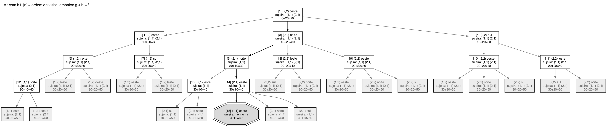
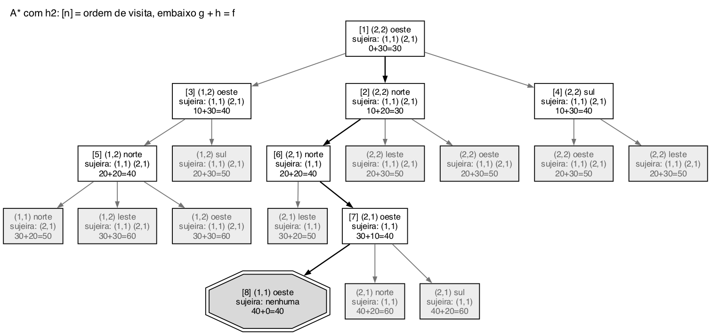

# Questão 17

## Modelagem

Pela figura do enunciado, a primeira coordenada é a **coluna** e a segunda é a **linha**. As sujeiras estão em (1,1) e (2,1), que é a linha de cima, e o robô está em (2,2), embaixo à direita, virado para o oeste, ou seja, para a esquerda. Norte é para cima.

```
        coluna 1   coluna 2
linha 1    *          *
linha 2               <       (robô virado para o oeste)
```

- **Estado:** (posição do robô, orientação, quadrados sujos)
- **Estado inicial:** ((2,2), oeste, {(1,1), (2,1)})
- **Teste de meta:** nenhum quadrado sujo
- **Ações, todas com custo 10:** avançar (só se a casa da frente estiver dentro da sala, e limpa a casa onde chega), girar 90° para a direita e girar 90° para a esquerda. Os sucessores são gerados sempre nessa ordem.

Usei o A* do mesmo jeito das outras questões: em árvore, gerando todos os sucessores, inclusive estados que se repetem (girar para a direita e depois para a esquerda volta para o mesmo estado), com teste de meta quando o nó sai da fronteira, e com empate resolvido pelo nó mais perto da raiz e depois pelo mais à esquerda.

## a) A* com h1(n) = 10 × Ns



Nodos na ordem em que foram visitados:

| Ordem | Posição | Orientação | Sujeira | g | h1 | f |
|:--:|:--:|:--|:--|:--:|:--:|:--:|
| 1 | (2,2) | oeste | (1,1) (2,1) | 0 | 20 | **20** |
| 2 | (1,2) | oeste | (1,1) (2,1) | 10 | 20 | **30** |
| 3 | (2,2) | norte | (1,1) (2,1) | 10 | 20 | **30** |
| 4 | (2,2) | sul | (1,1) (2,1) | 10 | 20 | **30** |
| 5 | (2,1) | norte | (1,1) | 20 | 10 | **30** |
| 6 | (1,2) | norte | (1,1) (2,1) | 20 | 20 | **40** |
| 7 | (1,2) | sul | (1,1) (2,1) | 20 | 20 | **40** |
| 8 | (2,2) | leste | (1,1) (2,1) | 20 | 20 | **40** |
| 9 | (2,2) | oeste | (1,1) (2,1) | 20 | 20 | **40** |
| 10 | (2,2) | oeste | (1,1) (2,1) | 20 | 20 | **40** |
| 11 | (2,2) | leste | (1,1) (2,1) | 20 | 20 | **40** |
| 12 | (1,1) | norte | (2,1) | 30 | 10 | **40** |
| 13 | (2,1) | leste | (1,1) | 30 | 10 | **40** |
| 14 | (2,1) | oeste | (1,1) | 30 | 10 | **40** |
| 15 | (1,1) | oeste | nenhuma | 40 | 0 | **40** |

**Solução:** girar para a direita (fica virado para o norte), avançar para (2,1) e limpar, girar para a esquerda (fica virado para o oeste), avançar para (1,1) e limpar. **Custo 40**, com **15 nodos visitados**. No momento em que achou a solução, ainda tinha 20 nodos esperando na fronteira.

Os nodos 9 e 10 são o próprio estado inicial gerado de novo, um girando para a direita e voltando, o outro girando para a esquerda e voltando. Isso acontece porque a busca é em árvore. O h1 não ajuda a separar esses estados, porque vale 20 para todos eles: enquanto nenhuma sujeira for limpa, todo estado tem a mesma estimativa e o A* fica abrindo todos os de f = 40 até chegar na solução.

## b) h1 é admissível

Para um estado ficar limpo, cada quadrado sujo precisa ser limpo, e o único jeito de limpar um quadrado é o robô **avançar para dentro dele**. Cada avanço limpa no máximo um quadrado e custa 10. Então, com Ns quadrados sujos, qualquer solução tem pelo menos Ns avanços, e o custo real é pelo menos 10 × Ns:

```
h1(n) = 10 × Ns ≤ h*(n)
```

A heurística nunca superestima, então é admissível. Ela também não considera os giros, que são exatamente a parte que ela "esquece" e que faz ela ser otimista.

## c) h2 que domina h1

A ideia vem de olhar para o que h1 esquece. Se ainda tem sujeira e **a casa da frente do robô não está suja**, a próxima ação não limpa nada: o robô precisa girar ou avançar para uma casa limpa antes de começar a limpar. Isso custa pelo menos uma ação a mais, ou seja, mais 10.

```
h2(n) = 10 × Ns + 10,  se Ns > 0 e a casa da frente do robô não está suja
h2(n) = 10 × Ns,       caso contrário
```

**Admissível:** o 10 × Ns continua sendo o mínimo de avanços, como em b). Quando a casa da frente não está suja, nenhuma solução consegue limpar alguma coisa na primeira ação, então pelo menos uma ação de 10 não limpa nada e soma ao custo. Nunca passa do custo real.

**Domina h1:** h2(n) ≥ h1(n) para todo n, porque h2 é h1 com 0 ou 10 a mais. Para o estado inicial, h1 = 20 e h2 = 30, e o custo real é 40.



Nodos na ordem em que foram visitados:

| Ordem | Posição | Orientação | Sujeira | g | h2 | f |
|:--:|:--:|:--|:--|:--:|:--:|:--:|
| 1 | (2,2) | oeste | (1,1) (2,1) | 0 | 30 | **30** |
| 2 | (2,2) | norte | (1,1) (2,1) | 10 | 20 | **30** |
| 3 | (1,2) | oeste | (1,1) (2,1) | 10 | 30 | **40** |
| 4 | (2,2) | sul | (1,1) (2,1) | 10 | 30 | **40** |
| 5 | (1,2) | norte | (1,1) (2,1) | 20 | 20 | **40** |
| 6 | (2,1) | norte | (1,1) | 20 | 20 | **40** |
| 7 | (2,1) | oeste | (1,1) | 30 | 10 | **40** |
| 8 | (1,1) | oeste | nenhuma | 40 | 0 | **40** |

**Solução:** a mesma, girar para a direita, avançar, girar para a esquerda e avançar. **Custo 40**, com **8 nodos visitados**. No fim, ficaram 11 nodos esperando na fronteira.

Com h2, o estado virado para o norte ((2,2), norte) tem h2 = 20, porque a casa da frente, (2,1), está suja. Os outros estados do primeiro nível têm 30. É isso que faz o A* ir direto para o lado certo.

## d) Comparando as duas árvores

| | h1 | h2 |
|:--|:--:|:--:|
| Nodos visitados | 15 | **8** |
| Nodos gerados | 35 | **19** |
| Nodos esperando no fim | 20 | **11** |
| Custo da solução | 40 | 40 |

As duas acharam a solução ótima de custo 40, como era de esperar, já que as duas são admissíveis. Mas com h2 o A* visitou quase metade dos nodos e gerou pouco mais da metade.

O motivo aparece nas duas árvores. Com h1, todos os estados com duas sujeiras têm o mesmo h = 20, e o A* não consegue distinguir quem está bem posicionado de quem está mal. Com h2, estar virado para uma casa suja vale 10 a menos, então os giros que não levam a nada, como virar para o leste ou voltar para o oeste depois de já estar virado para o norte, ficam com f = 50 e nem chegam a ser visitados. Isso é a dominância da questão 7 na prática: como h2 ≥ h1 e as duas são admissíveis, o A* com h2 nunca expande mais nós que com h1.

O enunciado da letra d pede para comparar as árvores das letras "a) e b)", mas a árvore com h2 é a da letra c, então comparei a e c.

## Resumo de como cheguei na solução

A primeira dificuldade foi entender as coordenadas. Pela figura, a sujeira está na linha de cima, então (1,1) e (2,1) precisam ser (coluna, linha). Com isso o robô em (2,2) fica embaixo à direita, e "oeste" é para a esquerda, que bate com a seta da figura. Depois defini o estado com as três informações que mudam: posição, orientação e quais casas ainda estão sujas. A sujeira precisa estar no estado, senão o teste de meta não teria como saber se acabou.

Antes de simular, achei a solução ótima pensando no problema: girar para o norte, avançar, girar para o oeste e avançar, com custo 40. Isso me deu um gabarito para conferir o A*. Simulei com h1 e vi que ele fica perdido no começo, porque todos os estados têm a mesma estimativa. Foi olhando isso que tive a ideia de h2: a h1 não percebe se o robô está virado para uma sujeira ou não. Somar 10 quando não está virado foi a correção mais simples que eu consegui justificar como admissível.

Por último simulei com h2 e montei a tabela comparando as duas árvores. A diferença de 15 para 8 nodos visitados deixou claro por que uma heurística que domina a outra é melhor.
