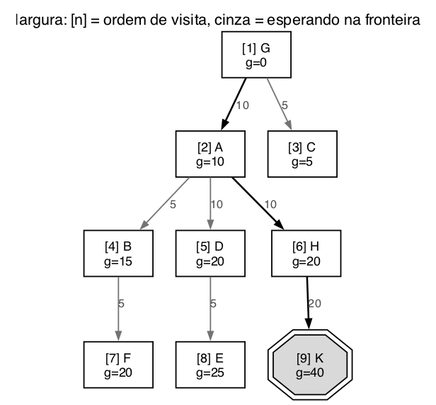
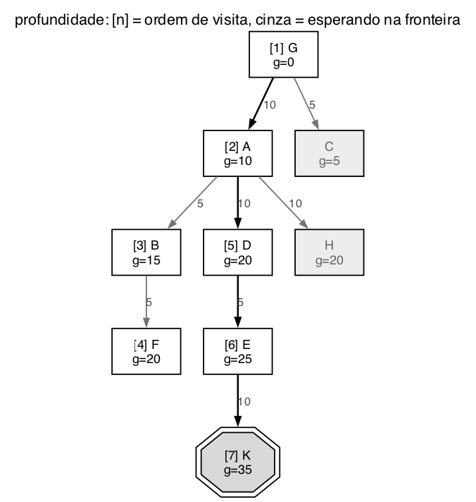
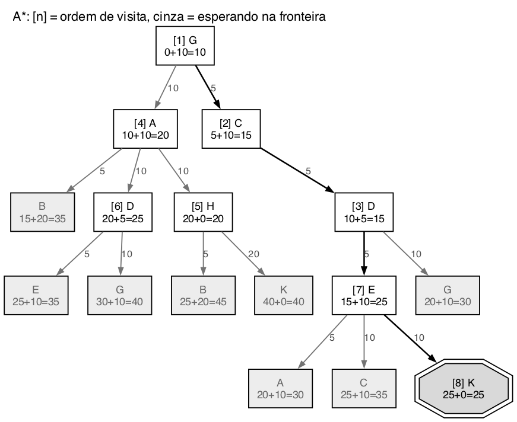

# Questão 18

O enunciado fala em "9 estados designados pelas letras A até K", mas o grafo tem só A, B, C, D, E, F, G, H e K. Não existem I e J, e são esses os 9 estados.

Como o grafo é dirigido, cada arco só vale no sentido da seta. Passei para uma lista de sucessores em ordem alfabética, junto com a heurística da letra c:

| Estado | Sucessores (custo) | h(n) |
|:--:|:--|:--:|
| A | B 5, D 10, H 10 | 10 |
| B | F 5 | 20 |
| C | D 5 | 10 |
| D | E 5, G 10 | 5 |
| E | A 5, C 10, K 10 | 10 |
| F | G 15 | 10 |
| G | A 10, C 5 | 10 |
| H | B 5, K 20 | 0 |
| K | B 10 | 0 (objetivo) |

O grafo tem vários ciclos, como G, A, B, F, G e G, C, D, G. Então, na largura e na profundidade, guardei a lista de estados já conhecidos e não deixei um estado entrar duas vezes na fronteira, igual fiz na Lista 1. Sem isso, a profundidade ficaria rodando G, A, B, F, G para sempre. No A* não precisa, porque o g vai crescendo a cada volta e o f acaba ficando grande demais para o nó ser escolhido. O teste de meta é feito quando o nó sai da fronteira, nas três buscas.

## a) Busca em largura

| Passo | Visitado | Novos na fronteira | Fronteira depois |
|:--:|:--|:--|:--|
| 1 | G | A, C | A, C |
| 2 | A | B, D, H | C, B, D, H |
| 3 | C | nenhum (D já conhecido) | B, D, H |
| 4 | B | F | D, H, F |
| 5 | D | E | H, F, E |
| 6 | H | K | F, E, K |
| 7 | F | nenhum | E, K |
| 8 | E | nenhum (A, C e K já conhecidos) | K |
| 9 | K | é a meta | vazia |

- **Ordem de visita:** G, A, C, B, D, H, F, E, K
- **Esperando para ser visitados quando acha a solução:** nenhum. Quando o K foi gerado, no passo 6, ainda estavam esperando F e E. Mas como a largura só testa a meta quando o K sai da fila, ela visitou F e E antes, e a fila terminou vazia.
- **Caminho:** G, A, H, K, com custo 10 + 10 + 20 = **40**

## b) Busca em profundidade

| Passo | Visitado | Novos na fronteira | Fronteira depois (topo à esquerda) |
|:--:|:--|:--|:--|
| 1 | G | A, C | A, C |
| 2 | A | B, D, H | B, D, H, C |
| 3 | B | F | F, D, H, C |
| 4 | F | nenhum (G já conhecido) | D, H, C |
| 5 | D | E | E, H, C |
| 6 | E | K | K, H, C |
| 7 | K | é a meta | H, C |

- **Ordem de visita:** G, A, B, F, D, E, K
- **Esperando para ser visitados quando acha a solução:** H e C
- **Caminho:** G, A, D, E, K, com custo 10 + 10 + 5 + 10 = **35**

## c) A*

Aqui a busca é em árvore, como nas outras questões. O mesmo estado pode aparecer mais de uma vez, chegando por caminhos diferentes. Os empates são resolvidos pelo nó mais perto da raiz.

| Passo | Visitado (g + h = f) | Fronteira depois do passo (f) |
|:--:|:--|:--|
| 1 | G (0 + 10 = 10) | A 20, C 15 |
| 2 | C (5 + 10 = 15) | A 20, D 15 |
| 3 | D (10 + 5 = 15) | A 20, E 25, G 30 |
| 4 | A (10 + 10 = 20) | E 25, G 30, B 35, D 25, H 20 |
| 5 | H (20 + 0 = 20) | E 25, G 30, B 35, D 25, B 45, K 40 |
| 6 | D, vindo de A (20 + 5 = 25) | E 25, G 30, B 35, B 45, K 40, E 35, G 40 |
| 7 | E, vindo de C e D (15 + 10 = 25) | G 30, B 35, B 45, K 40, E 35, G 40, A 30, C 35, K 25 |
| 8 | K (25 + 0 = 25) | é a meta |

- **Ordem de visita, com f:** G 10, C 15, D 15, A 20, H 20, D 25, E 25, K 25
- **Esperando para ser visitados quando acha a solução, com f:** G 30, B 35, B 45, K 40, E 35, G 40, A 30, C 35
- **Caminho:** G, C, D, E, K, com custo 5 + 5 + 5 + 10 = **25**

No passo 6 houve um empate: D, vindo de A, e E, vindo de C e D, estavam os dois com f = 25. D está na profundidade 2 e E na 3, então saiu D primeiro.

Um detalhe sobre a heurística: h(B) = 20 não é consistente no arco de B para F, porque 20 > 5 + h(F) = 15. Mas ela continua admissível. O caminho mais barato de B até K é B, F, G, C, D, E, K, que custa 45. Por isso o A* em árvore ainda garante a solução ótima.

## d) Qual é a melhor para esse problema

| Busca | Nós visitados | Esperando no fim | Caminho | Custo |
|:--|:--:|:--:|:--|:--:|
| Largura | 9 | 0 | G, A, H, K | 40 |
| Profundidade | 7 | 2 | G, A, D, E, K | 35 |
| A* | 8 | 8 | G, C, D, E, K | **25** |

**A melhor é o A\*.** Ele foi o único que achou o caminho de menor custo, 25, e conferindo todos os caminhos de G até K, esse é mesmo o ótimo. A largura achou o caminho com menos arcos, só 3, mas eles são caros e o total deu 40. A profundidade deu 35 e foi a que visitou menos nós, mas por sorte da ordem alfabética.

O custo do A* foi a memória: terminou com 8 nós esperando na fronteira, contra 0 e 2 das outras. Num grafo desse tamanho isso não pesa nada. Como o problema tem custos bem diferentes entre os arcos (de 5 até 20), quem ignora o custo, como a largura e a profundidade, tende a errar. Então o A* é o mais indicado.

## Resumo de como cheguei na solução

O primeiro cuidado foi com as setas, porque o grafo é dirigido e é muito fácil inverter um arco olhando a figura. Montei a tabela de sucessores conferindo com o exemplo do enunciado, que diz que de G se chega em A com custo 10. Também notei que o enunciado fala em letras de A até K, mas não existem I e J.

Depois percebi que o grafo tem ciclos, e que a profundidade sem controle de repetidos nunca ia terminar. Por isso usei a lista de estados conhecidos na largura e na profundidade, como na Lista 1. No A* deixei em árvore, igual ao professor fez na aula, e acompanhei a fronteira completa a cada passo, que é o que a questão pede no final. Antes de responder a letra d, calculei o caminho mais barato de G até K por conta própria, para ter certeza de que os 25 do A* eram mesmo o ótimo.
