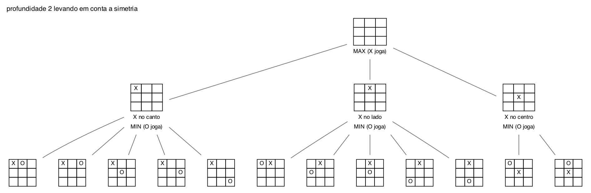
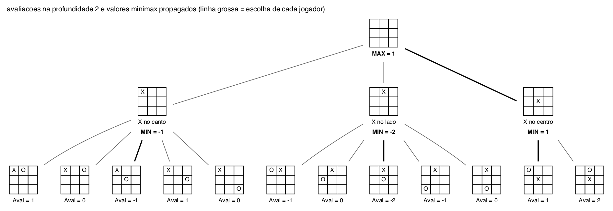
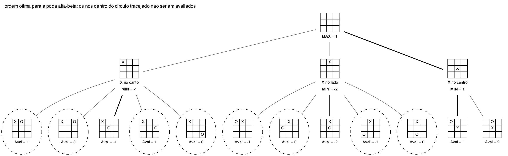

# Questão 1

X joga primeiro e é o jogador MAX. O é o MIN. A função de avaliação para posições que não terminaram é:

```
Aval(s) = 3·X2(s) + X1(s) − (3·O2(s) + O1(s))
```

em que Xn é o número de linhas, colunas ou diagonais com exatamente n X e nenhum O, e o mesmo para O. O tabuleiro tem 8 linhas possíveis: 3 linhas, 3 colunas e 2 diagonais.

## a) Quantos jogos existem, aproximadamente

Um limite fácil é **9! = 362.880**: o primeiro jogador tem 9 casas para escolher, o segundo 8, depois 7, e assim por diante até preencher o tabuleiro.

Esse número é maior que o real, porque muitos jogos terminam antes das 9 jogadas, quando alguém fecha uma linha. Para ter o valor certo, fiz um programa ([`codigo/questao-01.py`](codigo/questao-01.py)) que joga todas as partidas possíveis e para cada uma assim que alguém ganha ou o tabuleiro enche. Deu **255.168 jogos diferentes**. Então a resposta aproximada é algo entre 250 e 360 mil jogos.

Se levarmos em conta a simetria, ou seja, tratar como iguais os tabuleiros que são só rotação ou espelho um do outro, esse número cai bastante, e é isso que a letra b usa.

## b) Árvore até a profundidade 2, levando em conta a simetria

O tabuleiro tem 8 simetrias: 4 rotações e os espelhos de cada uma. Por causa delas, a primeira jogada de X só tem **3 posições realmente diferentes**: no **canto** (os 4 cantos são iguais), no **lado** (as 4 casas do meio das bordas são iguais) e no **centro**.

Para cada uma dessas, contei as respostas de O que não são espelho uma da outra:

- X no canto: 5 respostas diferentes
- X no lado: 5 respostas diferentes
- X no centro: 2 respostas diferentes, O no canto ou O no lado

Isso dá **12 posições na profundidade 2**.



## c) Avaliação das posições na profundidade 2

Para cada posição contei as linhas abertas de cada jogador. Com uma peça só de cada lado, X2 e O2 são sempre 0, então a conta fica Aval = X1 − O1.

| Primeira jogada de X | Resposta de O | X1 | O1 | Aval |
|:--|:--|:--:|:--:|:--:|
| canto | lado vizinho | 2 | 1 | **1** |
| canto | canto da mesma linha | 2 | 2 | **0** |
| canto | centro | 2 | 3 | **−1** |
| canto | lado afastado | 3 | 2 | **1** |
| canto | canto oposto | 2 | 2 | **0** |
| lado | canto vizinho | 1 | 2 | **−1** |
| lado | lado vizinho | 2 | 2 | **0** |
| lado | centro | 1 | 3 | **−2** |
| lado | canto afastado | 2 | 3 | **−1** |
| lado | lado oposto | 1 | 1 | **0** |
| centro | canto | 3 | 2 | **1** |
| centro | lado | 3 | 1 | **2** |

Exemplo de uma conta: X no centro e O no canto de cima à esquerda. As linhas que passam pelo centro são 4: a do meio, a coluna do meio e as duas diagonais. A diagonal que passa pelo canto do O tem um O, então X fica com 3 linhas abertas. O fica com as linhas que passam pelo canto dele e não têm X: a linha de cima e a coluna da esquerda, que são 2. Aval = 3 − 2 = 1.

## d) Valores minimax e melhor movimento inicial

No nível 1 quem joga é O, que é MIN, então cada nó recebe o **menor** valor dos filhos. Na raiz quem escolhe é X, que é MAX, então ela recebe o **maior** valor.



| Primeira jogada de X | Valor MIN (pior caso para X) |
|:--|:--:|
| canto | min(1, 0, −1, 1, 0) = **−1** |
| lado | min(−1, 0, −2, −1, 0) = **−2** |
| centro | min(1, 2) = **1** |

Raiz: max(−1, −2, 1) = **1**.

**O melhor movimento inicial é jogar no centro.** Ele é o único em que, mesmo O respondendo da melhor forma para ele (no canto), X fica com uma posição positiva. No canto e no lado, O pode responder no centro e deixar X com valor negativo. O centro é a casa que participa de mais linhas, 4 das 8, por isso ocupar ele dá mais linhas abertas para X e tira linhas de O.

## e) Nós que não seriam avaliados com a poda alfa-beta na ordem ótima

A ordem ótima é aquela em que o melhor filho de cada nó é gerado primeiro:

1. Na raiz, que é MAX, o primeiro filho é o **centro**, que é o de maior valor.
2. Em cada nó MIN, o primeiro filho é o de **menor** valor, que é a melhor resposta de O.

Simulando com essa ordem:

- **Centro.** É o primeiro ramo, então ainda não tem nenhum limite para comparar, e os 2 filhos precisam ser avaliados para saber o valor exato do nó: min(1, 2) = 1. Agora a raiz tem α = 1, ou seja, X já garante pelo menos 1.
- **Canto.** O primeiro filho avaliado é O no centro, com −1. Como o nó é MIN, ele vai valer no máximo −1. Mas a raiz já tem 1 garantido pelo centro, então nada nesse ramo pode mudar a escolha de X. Os outros 4 filhos são podados.
- **Lado.** O primeiro filho avaliado é O no centro, com −2. Pelo mesmo motivo, os outros 4 filhos são podados.



Os nós no círculo tracejado não seriam avaliados: **8 das 12 posições**. Só 4 posições precisam ser avaliadas: as 2 do centro, O no centro depois de X no canto e O no centro depois de X no lado.

## Resumo de como cheguei na solução

Para a letra a usei primeiro a conta de 9!, que dá um limite fácil, e depois fiz um programa que joga todas as partidas, porque queria saber o quanto o fim antecipado das partidas diminuía esse número.

Para a árvore, a parte mais importante foi entender a simetria. Percebi que não precisava desenhar 9 jogadas para X, porque um X em qualquer canto é a mesma situação girando o tabuleiro. Fiz o mesmo raciocínio para as respostas de O, olhando quais ficavam iguais por espelho. Depois calculei a função de avaliação de cada uma das 12 posições, contando linha por linha as que estavam abertas para cada jogador. A função é parecida com a que o professor mostrou na aula, que é a diferença de linhas onde cada um ainda pode ganhar.

Com os valores, apliquei o minimax de baixo para cima, como na aula: no nível de O pega o menor, porque assume que o adversário joga bem, e na raiz pega o maior. Para a poda alfa-beta, pensei qual ordem faria a poda cortar mais. Se o centro, que dá α = 1, vier primeiro, basta achar uma resposta de O que deixe o canto e o lado abaixo de 1 para cortar o resto, e a melhor resposta de O nos dois casos é o centro. Por isso só sobram 4 posições avaliadas.
