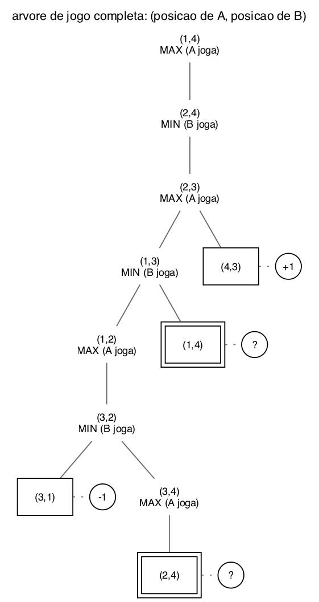
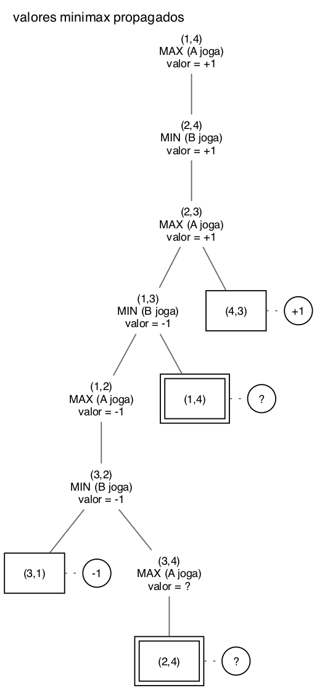

# Questão 2

O tabuleiro tem 4 casas, numeradas de 1 a 4. A começa na casa 1 e B na casa 4. A ganha quando chega na casa 4, e B ganha quando chega na casa 1. Usei o ponto de vista de A: **+1 se A ganha e −1 se B ganha**. A é o MAX e B é o MIN.

As regras de movimento, aplicadas em cada estado:

- o jogador anda uma casa para a esquerda ou para a direita, se ela estiver vazia;
- se a casa ao lado estiver ocupada pelo adversário, ele pula por cima, desde que a casa depois exista e esteja vazia;
- ele é obrigado a mover.

## a) Árvore de jogo completa

Cada estado é (sA, sB). O jogador da vez está escrito embaixo, porque o mesmo par de posições é um estado diferente dependendo de quem vai jogar.

Como a árvore foi montada, a partir da raiz:

| Estado | Vez | Jogadas possíveis | Por quê |
|:--|:--:|:--|:--|
| (1,4) | A | (2,4) | A na casa 1 só pode ir para a 2 |
| (2,4) | B | (2,3) | B na casa 4 só pode ir para a 3 |
| (2,3) | A | (1,3) e (4,3) | A volta para a 1, ou pula o B e cai na 4 |
| (4,3) | | **terminal, +1** | A chegou na casa 4 |
| (1,3) | B | (1,2) e (1,4) | B vai para a 2, ou volta para a 4 |
| (1,4) | A | **repetido, ?** | é o estado inicial de novo |
| (1,2) | A | (3,2) | A na 1 está colado no B, então pula e cai na 3 |
| (3,2) | B | (3,1) e (3,4) | B vai para a 1, ou pula o A e cai na 4 |
| (3,1) | | **terminal, −1** | B chegou na casa 1 |
| (3,4) | A | (2,4) | A só pode voltar para a 2, porque o B está na 4 e não tem casa para pular |
| (2,4) | B | **repetido, ?** | já apareceu no segundo nível |

Os estados terminais estão em quadrados, com o valor num círculo. Os estados repetidos estão em quadrados duplos com "?".

## b) Valores minimax propagados e como tratei o "?"

Subindo de baixo para cima:

| Estado | Tipo | Filhos | Valor |
|:--|:--:|:--|:--:|
| (3,4) | MAX | ? | **?** |
| (3,2) | MIN | −1, ? | **−1** |
| (1,2) | MAX | −1 | **−1** |
| (1,3) | MIN | −1, ? | **−1** |
| (2,3) | MAX | −1, +1 | **+1** |
| (2,4) | MIN | +1 | **+1** |
| (1,4) | MAX | +1 | **+1** |

**Como tratei o "?".** Um estado repetido não tem valor definido, porque se o jogo entrar nele os jogadores podem ficar andando em círculo. Mas, qualquer que seja esse valor, ele está entre −1 e +1. Então:

- Num nó **MIN** com um filho −1, o MIN já tem a melhor jogada possível para ele, que é ganhar. O "?" não pode ser melhor que isso, então **min(−1, ?) = −1**. Foi o que aconteceu em (3,2) e em (1,3).
- Num nó **MAX** com um filho +1, vale o mesmo: **max(+1, ?) = +1**.
- Quando o "?" é a única opção, ou quando não dá para decidir sem ele, o nó continua **"?"**. Foi o caso de (3,4), que só tem o filho repetido.

Fiz assim porque o "?" só importa quando ele pode mudar a escolha. Se o jogador já tem uma vitória garantida em outro filho, ele nunca vai escolher o ramo repetido, então o valor desse ramo não faz diferença.

O resultado é que **a raiz vale +1: A ganha**, se jogar direito. Em (2,3), A pula o B e chega na casa 4.

## c) Por que o minimax padrão falha e como corrigir

**O problema.** O minimax padrão é uma busca em profundidade que desce até achar um estado terminal. Só que esse jogo tem ciclos: dá para ir de (1,4) até (1,4) de novo, passando por (2,4), (2,3) e (1,3). Quando o minimax chegasse no estado repetido, ele não saberia que já passou por ali e expandiria tudo de novo, e de novo, sem nunca terminar. A árvore real do jogo é **infinita**, e uma busca em profundidade num ramo infinito não volta. É o mesmo problema da busca em profundidade da Lista 1.

**A correção**, baseada no que fiz na letra b:

1. **Guardar o caminho atual.** A cada chamada recursiva, passar junto a lista de estados (com o jogador da vez) que estão no caminho da raiz até ali.
2. **Detectar a repetição.** Antes de expandir um estado, olhar se ele já está nesse caminho. Se estiver, não expandir e devolver "?".
3. **Propagar o "?" com as regras da letra b.** No MAX, se algum filho vale +1, o nó vale +1. No MIN, se algum filho vale −1, o nó vale −1. Fora isso, o "?" sobe.

Com isso a árvore fica finita, como a que desenhei, e o minimax termina.

Uma ressalva: essa correção funciona bem aqui porque o jogo só tem vitória ou derrota, e sempre existe uma saída que decide o jogo antes do ciclo importar. Num jogo em que o ciclo pode ser a melhor opção para alguém, o "?" precisaria de um valor de verdade, por exemplo 0 como empate.

## Resumo de como cheguei na solução

Montei a árvore aplicando as regras em cada estado, e fui anotando o porquê de cada jogada numa tabela, porque a regra do pulo é fácil de errar. Por exemplo, em (1,2) A não pode ir para a 2, que está ocupada, e é obrigado a pular. Também percebi que precisava anotar de quem é a vez, porque (2,4) com B jogando e (2,4) com A jogando seriam estados diferentes. Quando um estado com o mesmo jogador da vez apareceu de novo no caminho, marquei como repetido.

A parte do "?" foi a que mais me fez pensar. A ideia veio de lembrar que o MIN, no minimax, sempre escolhe o menor valor: se ele já tem um −1, qualquer outro filho é igual ou pior para ele. Com isso, só o (3,4) ficou sem valor, e ele não afetou a raiz. Para a letra c, relacionei com a busca em profundidade da Lista 1, que também não termina quando o espaço tem ciclo. A solução foi a mesma ideia de lá, guardar o caminho, só que adaptada para o "?".
