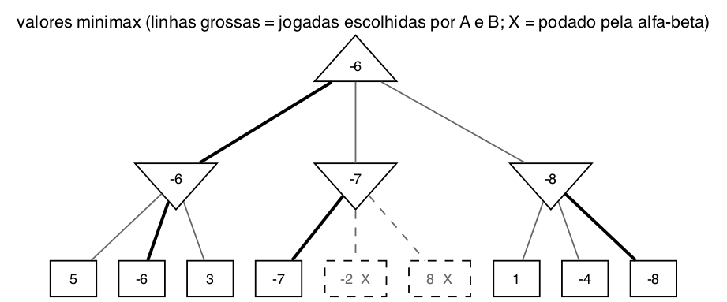

# Questão 3

A raiz é de A, que é MAX. O nível do meio é de B, que é MIN. As folhas já estão com a utilidade para A.

## a) Valores minimax dos nós internos

Subindo de baixo para cima, como o professor fez na aula:

| Nó | Tipo | Filhos | Valor |
|:--|:--:|:--|:--:|
| B esquerda | MIN | 5, −6, 3 | **−6** |
| B meio | MIN | −7, −2, 8 | **−7** |
| B direita | MIN | 1, −4, −8 | **−8** |
| A (raiz) | MAX | −6, −7, −8 | **−6** |

## b) Jogadas escolhidas por A e por B

Na figura, as arestas escolhidas estão com a linha mais grossa:

- **A escolhe o ramo da esquerda**, que vale −6, porque é o maior entre −6, −7 e −8.
- **Em cada nó, B escolhe a folha de menor valor:** −6 no ramo da esquerda, −7 no do meio e −8 no da direita.

A jogada que de fato acontece, com os dois jogando bem, é A indo para a esquerda e B respondendo com o −6. Todos os resultados são negativos, então A vai perder de qualquer jeito, e o minimax escolhe o ramo em que ele perde menos.

## c) Nós podados pela alfa-beta, da esquerda para a direita

Simulei guardando o α da raiz, que é o melhor que A já garantiu, e o β de cada nó de B, que é o melhor que B já garantiu:

| Passo | Onde | O que acontece | α (raiz) | β (nó B) |
|:--:|:--|:--|:--:|:--:|
| 1 | B esquerda, folha 5 | B pode ficar com 5 | −∞ | 5 |
| 2 | B esquerda, folha −6 | −6 é menor, B fica com −6 | −∞ | −6 |
| 3 | B esquerda, folha 3 | 3 não melhora para B | −∞ | −6 |
| 4 | volta para a raiz | A garante pelo menos −6 | **−6** | |
| 5 | B meio, folha −7 | B pode ficar com −7. Como −7 ≤ α = −6, A nunca vai escolher esse ramo | −6 | −7 |
| | | **poda as folhas −2 e 8** | | |
| 6 | B direita, folha 1 | 1 > −6, ainda pode interessar a A | −6 | 1 |
| 7 | B direita, folha −4 | −4 > −6, continua | −6 | −4 |
| 8 | B direita, folha −8 | B fica com −8 | −6 | −8 |

**Nós podados: as folhas −2 e 8**, do ramo do meio. Na figura estão marcados com X.

O motivo é o que o professor explicou na aula: depois de ver o −7, o nó do meio só pode valer −7 ou menos, porque é MIN. A já tem −6 garantido pelo ramo da esquerda, que é melhor. Então não importa o que tem nas outras folhas, porque elas nunca vão fazer A escolher esse ramo.

No ramo da direita não teve poda. O 1 e o −4 são maiores que −6, então até chegar na última folha ainda era possível o ramo valer mais que −6. O −8 só aparece na última folha, quando já não tem mais nada para cortar.

## Resumo de como cheguei na solução

Para os valores, apliquei o minimax de baixo para cima: o nó MIN pega o menor dos filhos e a raiz, que é MAX, pega o maior. Depois marquei as jogadas seguindo de onde veio cada valor.

Para a poda, simulei como busca em profundidade da esquerda para a direita, anotando o α da raiz e o β de cada nó MIN, igual o professor fez no exemplo da aula. O ramo da esquerda precisa ser visto inteiro, porque ainda não tem limite para comparar. No do meio, a primeira folha já ficou abaixo do −6 que A tinha garantido, e aí deu para podar. No da direita, conferi folha por folha e vi que não dava para podar, porque as duas primeiras eram maiores que −6. Isso mostrou que a quantidade de poda depende muito da ordem das folhas: se o −8 viesse primeiro, as folhas 1 e −4 também seriam podadas.
