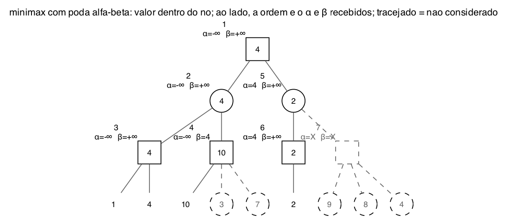

# Questão 4

Os quadrados são nós MAX e os círculos são nós MIN. Pela numeração, a árvore é:

```
                 1 (MAX)
          /                 \
     2 (MIN)                 5 (MIN)
     /      \               /       \
 3 (MAX)   4 (MAX)      6 (MAX)    7 (MAX)
  1  4    10  3  7         2       9  8  4
```

## a) Valores minimax

De baixo para cima:

| Nó | Tipo | Filhos | Valor |
|:--:|:--:|:--|:--:|
| 3 | MAX | 1, 4 | **4** |
| 4 | MAX | 10, 3, 7 | **10** |
| 6 | MAX | 2 | **2** |
| 7 | MAX | 9, 8, 4 | **9** |
| 2 | MIN | 4, 10 | **4** |
| 5 | MIN | 2, 9 | **2** |
| 1 | MAX | 4, 2 | **4** |

**O valor do jogo é 4.** MAX vai para o nó 2, MIN responde com o nó 3, e MAX fica com a folha 4.

## b) Execução do α-β

**Uma observação sobre o enunciado:** ele diz que o algoritmo começa com "α = −∞ e β = −∞", mas a figura mostra α = −∞ e β = ∞ na raiz, que é o certo. Se β começasse em −∞, já teríamos α ≥ β na raiz e tudo seria podado antes de começar. Usei **α = −∞ e β = +∞**.

As regras que usei:

- α é o melhor valor que **MAX** já garantiu no caminho até o nó, e β é o melhor que **MIN** já garantiu.
- Um nó MAX atualiza o α com o valor dos filhos. Um nó MIN atualiza o β.
- Quando α ≥ β, os filhos que faltam são podados.
- O α e o β que cada filho recebe são os valores do pai **no momento da chamada**.



Passo a passo:

| Passo | Nó | α, β recebidos | O que acontece |
|:--:|:--:|:--:|:--|
| 1 | 1 (MAX) | −∞, +∞ | chama o nó 2 |
| 2 | 2 (MIN) | −∞, +∞ | chama o nó 3 |
| 3 | 3 (MAX) | −∞, +∞ | folha 1, α = 1. Folha 4, α = 4. Devolve **4** |
| 4 | 2 (MIN) | | recebe 4, β = 4. Chama o nó 4 com α = −∞, β = 4 |
| 5 | 4 (MAX) | −∞, 4 | folha 10, α = 10. Como **10 ≥ β = 4**, poda as folhas **3 e 7**. Devolve **10** |
| 6 | 2 (MIN) | | min(4, 10) = **4**. Devolve 4 |
| 7 | 1 (MAX) | | recebe 4, α = 4. Chama o nó 5 com α = 4, β = +∞ |
| 8 | 5 (MIN) | 4, +∞ | chama o nó 6 com α = 4, β = +∞ |
| 9 | 6 (MAX) | 4, +∞ | folha 2. α continua 4, porque 2 < 4. Devolve **2** |
| 10 | 5 (MIN) | | recebe 2, β = 2. Como **α = 4 ≥ β = 2**, poda o **nó 7 inteiro**. Devolve 2 |
| 11 | 1 (MAX) | | max(4, 2) = **4** |

### i) Nós e folhas que NÃO são considerados

- **as folhas 3 e 7 do nó 4**: depois de ver o 10, o nó 4 já vale pelo menos 10, e o nó 2, que é MIN, já tinha o 4 do nó 3. MIN nunca vai escolher o nó 4.
- **o nó 7 e suas três folhas, 9, 8 e 4**: depois de ver o nó 6, o nó 5 vale no máximo 2, e a raiz já tem 4 garantido pelo nó 2. MAX nunca vai escolher o nó 5, então o nó 7 nem é chamado.

### ii) Valores de α e β passados para cada nó

| Nó | α | β |
|:--:|:--:|:--:|
| 1 | −∞ | +∞ |
| 2 | −∞ | +∞ |
| 3 | −∞ | +∞ |
| 4 | −∞ | 4 |
| 5 | 4 | +∞ |
| 6 | 4 | +∞ |
| 7 | X | X |

O nó 7 fica com X nos dois, porque foi podado e nunca recebeu chamada, como o enunciado pede.

O resultado da α-β é o mesmo do minimax da letra a, **4 na raiz**, mas olhando só 4 das 9 folhas (1, 4, 10 e 2).

## Resumo de como cheguei na solução

O enunciado avisa para ler as duas partes da letra b antes de começar, e entendi o porquê: o α e o β que vão em cada nó são os do momento da chamada, e não o valor final do nó. Então fiz a letra a primeiro, separado, e depois simulei a α-β como uma busca em profundidade, anotando numa tabela o α e o β que cada nó recebia e como eles mudavam.

Antes de começar, estranhei o β = −∞ do enunciado e conferi na figura, que mostra β = ∞. Fiz a conta e vi que, com β = −∞, a raiz já começaria com α ≥ β, o que não faz sentido. Por isso usei +∞.

Os dois cortes seguem a mesma lógica que o professor mostrou na aula. No nó 4, o MAX encontrou 10, mas o MIN de cima já tinha 4, então nenhum valor maior ia ser escolhido. No nó 5, o MIN chegou em 2, mas o MAX da raiz já tinha 4. O segundo corte foi o que mais economizou, porque tirou um nó inteiro com três folhas.
