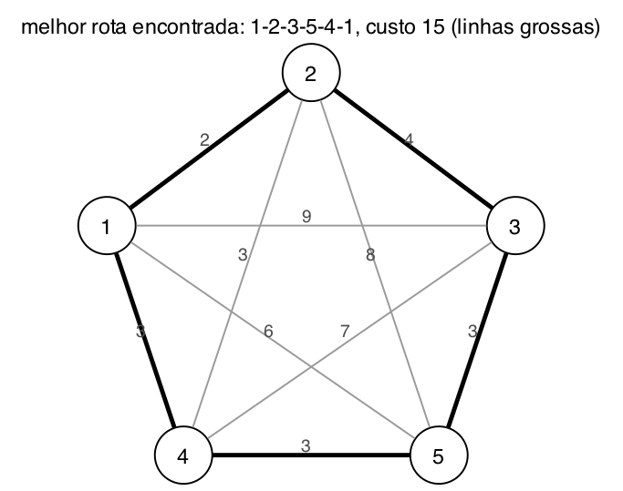

# Questão 6

Distâncias do grafo, em km. Todas as cidades são ligadas entre si:

| | 1 | 2 | 3 | 4 | 5 |
|:--:|:--:|:--:|:--:|:--:|:--:|
| **1** | | 2 | 9 | 3 | 6 |
| **2** | 2 | | 4 | 3 | 8 |
| **3** | 9 | 4 | | 7 | 3 |
| **4** | 3 | 3 | 7 | | 3 |
| **5** | 6 | 8 | 3 | 3 | |

Considerei que a rota passa uma vez por cada cidade e **volta para a cidade de onde saiu**, como no caixeiro viajante que o professor mostrou na aula. Toda a simulação está no programa [`codigo/questao-06.py`](codigo/questao-06.py), com semente fixa, e a saída completa está em [`codigo/saida-questao-06.txt`](codigo/saida-questao-06.txt).

## a) Codificação dos cromossomos

O cromossomo é um **vetor com a ordem em que as cidades são visitadas**, e cada gene é uma cidade. Por exemplo:

```
cromossomo [1, 3, 2, 5, 4]  →  rota 1 → 3 → 2 → 5 → 4 → 1
```

O último trecho, da cidade 4 de volta para a 1, não aparece no vetor, mas entra no custo.

Usei um vetor de inteiros em vez de bits, igual ao exemplo do caixeiro viajante da aula, porque assim todo cromossomo é uma permutação. Cada cidade aparece exatamente uma vez, que é a regra do problema. Como expliquei na questão 3, com bits um cruzamento poderia repetir cidades e gerar rotas inválidas.

## b) Função de fitness

O custo da rota é a soma das distâncias, incluindo a volta:

```
custo(c) = d(c1, c2) + d(c2, c3) + d(c3, c4) + d(c4, c5) + d(c5, c1)
```

Como queremos a rota **mais curta** e o algoritmo genético prefere o fitness **maior**, inverti o custo:

```
fitness(c) = 1 / custo(c)
```

Assim, a rota mais barata tem o maior fitness.

## c) Dois cromossomos e a aptidão deles

| Cromossomo | Rota | Custo | Fitness |
|:--:|:--|:--|:--:|
| P1 = [1, 3, 2, 5, 4] | 1-3-2-5-4-1 | 9 + 4 + 8 + 3 + 3 = **27** | 1/27 ≈ 0,037 |
| P2 = [1, 4, 3, 2, 5] | 1-4-3-2-5-1 | 3 + 7 + 4 + 8 + 6 = **28** | 1/28 ≈ 0,036 |

Escolhi duas rotas ruins de propósito, para dar espaço para o algoritmo melhorar. As duas usam trechos caros, como o 1-3 de 9 km e o 2-5 de 8 km.

## d) Cruzamento

Usei o **cruzamento baseado em ordem** do slide do caixeiro viajante. Sorteia-se um pedaço de um pai, que vai para o filho na mesma posição. O resto do filho é completado com as cidades que faltam, **na ordem em que aparecem no outro pai**. Isso garante que nenhuma cidade se repete.

Na primeira geração, foram sorteadas as posições 2 e 3:

```
P1 = [1, |3, 2|, 5, 4]       pedaço do P1: 3, 2
P2 = [1,  4, 3,  2, 5]       ordem no P2 sem o 3 e o 2: 1, 4, 5

Filho 1 = [1, |3, 2|, 4, 5]  →  1-3-2-4-5-1, custo 9 + 4 + 3 + 3 + 6 = 25
```

E o contrário, com o pedaço do P2 e a ordem do P1:

```
P2 = [1, |4, 3|, 2, 5]       pedaço do P2: 4, 3
P1 = [1,  3, 2,  5, 4]       ordem no P1 sem o 4 e o 3: 1, 2, 5

Filho 2 = [1, |4, 3|, 2, 5]  →  igual ao P2, custo 28
```

O filho 1 já ficou melhor que os dois pais, com 25 contra 27 e 28.

## e) Mutação

Usei a **mutação por troca**, que também é do slide: sorteiam-se duas posições e as duas cidades trocam de lugar. Na primeira geração:

```
Filho 1 = [1, 3, |2|, |4|, 5]   troca das posições 3 e 4   →  [1, 3, 4, 2, 5], custo 33
Filho 2 = [|1|, 4, 3, 2, |5|]   troca das posições 1 e 5   →  [5, 4, 3, 2, 1], custo 22
```

A mutação estragou o filho 1, que foi de 25 para 33, mas melhorou bastante o filho 2, que foi de 28 para 22. Ela é aleatória, então pode ajudar ou atrapalhar.

## f) Cinco gerações

Em cada geração: os 2 pais cruzam, os 2 filhos sofrem mutação, e **sobrevivem os 2 melhores entre pais e filhos**. Essa forma de manter os melhores se chama elitismo, e garante que a melhor rota nunca se perde.

| Geração | Pais (custo) | Filhos depois da mutação (custo) | Sobrevivem (custo) |
|:--:|:--|:--|:--|
| 1 | 1-3-2-5-4 (27), 1-4-3-2-5 (28) | 1-3-4-2-5 (33), 5-4-3-2-1 (22) | **5-4-3-2-1 (22)**, 1-3-2-5-4 (27) |
| 2 | 5-4-3-2-1 (22), 1-3-2-5-4 (27) | 5-3-4-2-1 (21), 1-5-2-3-4 (28) | **5-3-4-2-1 (21)**, 5-4-3-2-1 (22) |
| 3 | 5-3-4-2-1 (21), 5-4-3-2-1 (22) | 5-1-3-2-4 (25), 5-2-4-3-1 (33) | **5-3-4-2-1 (21)**, 5-4-3-2-1 (22) |
| 4 | 5-3-4-2-1 (21), 5-4-3-2-1 (22) | 4-5-3-2-1 (15), 4-3-5-2-1 (23) | **4-5-3-2-1 (15)**, 5-3-4-2-1 (21) |
| 5 | 4-5-3-2-1 (15), 5-3-4-2-1 (21) | 5-4-3-1-2 (29), 5-3-4-1-2 (23) | **4-5-3-2-1 (15)**, 5-3-4-2-1 (21) |

Evolução da melhor rota:

```
geração:   0    1    2    3    4    5
custo:    27 → 22 → 21 → 21 → 15 → 15
```

**Melhor rota encontrada:** 4-5-3-2-1-4, com **custo 15**. É a mesma rota que **1-2-3-5-4-1**, só lida ao contrário e começando em outra cidade. Num ciclo isso não muda nada: 2 + 4 + 3 + 3 + 3 = 15.



### É o melhor resultado possível?

**Sim.** Para conferir, calculei o custo de todas as rotas possíveis. Com 5 cidades, fixando a cidade inicial e contando ida e volta como a mesma rota, existem só (5 − 1)! / 2 = **12 rotas diferentes**:

| Rota | Custo | | Rota | Custo |
|:--|:--:|:--:|:--|:--:|
| **1-2-3-5-4-1** | **15** | | 1-2-5-3-4-1 | 23 |
| 1-4-2-3-5-1 | 19 | | 1-3-2-4-5-1 | 25 |
| 1-2-4-5-3-1 | 20 | | 1-3-5-2-4-1 | 26 |
| 1-2-4-3-5-1 | 21 | | 1-3-2-5-4-1 | 27 |
| 1-2-3-4-5-1 | 22 | | 1-4-3-2-5-1 | 28 |
| | | | 1-2-5-4-3-1 | 29 |
| | | | 1-3-4-2-5-1 | 33 |

O algoritmo genético chegou na **rota ótima** na geração 4, partindo de duas rotas que estavam entre as piores (27 e 28).

Mas isso depende dos sorteios. Testei o mesmo programa com outras sementes, e na maioria ele também chegou no 15 em até 5 gerações, mas em uma delas terminou com 19. Com uma população de só 2 indivíduos há pouca diversidade, e o algoritmo depende muito da mutação para sair do lugar. Dá para ver isso na tabela: nas gerações 2, 3 e 4 o cruzamento só devolveu os próprios pais, porque eles eram muito parecidos, e quem trouxe as melhorias foi a mutação. Com uma população maior, o resultado seria mais confiável.

Se a rota não precisasse voltar para a cidade inicial, o melhor caminho seria 1-2-4-5-3, com 2 + 3 + 3 + 3 = 11.

## Resumo de como cheguei na solução

Comecei montando a tabela de distâncias a partir do grafo, porque com 10 estradas cruzadas no desenho é fácil confundir qual número é de qual linha. Depois defini o cromossomo como a ordem das cidades. Esse foi o ponto mais importante, porque com essa representação cada cidade aparece uma vez só, e a regra do problema já fica garantida pela própria estrutura.

Para o fitness, inverti o custo, porque o problema é de minimização. Para o cruzamento e a mutação, usei os dois operadores que o professor mostrou no exemplo do caixeiro viajante, o baseado em ordem e a troca de cidades, porque os operadores de bits iriam repetir cidades.

As 5 gerações eu rodei num programa em Python com semente fixa, mostrando cada passo, para os sorteios não serem inventados por mim e qualquer pessoa poder conferir. Para responder se o resultado era o melhor possível, calculei o custo das 12 rotas que existem e confirmei que 15 é o mínimo. Também rodei com outras sementes, e foi assim que percebi que, com uma população tão pequena, o resultado depende bastante da sorte.
