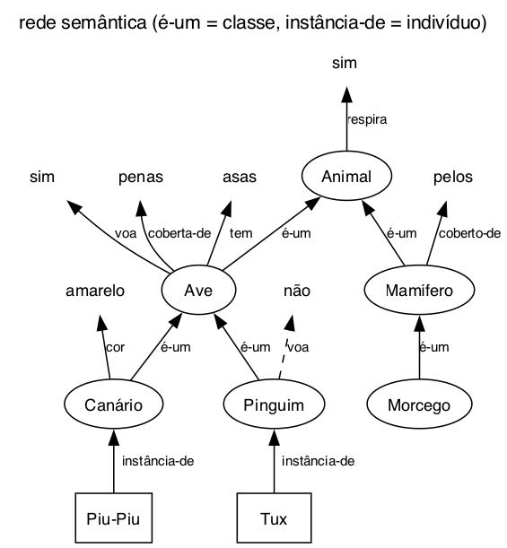
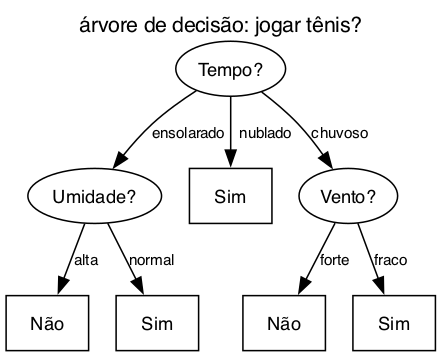

# Questão 2

Pra cada paradigma escrevi como ele guarda o conhecimento e dei um exemplo de aplicação.

**a) Lógica**

O conhecimento vira sentenças com predicados, variáveis, conectivos (∧, ⇒) e quantificadores (∀ "para todo", ∃ "existe algum"), e as conclusões saem por regras de inferência como o modus ponens.

Aplicação: o próprio caso do Capitão West da aula, onde a lei americana vira regra lógica e o sistema conclui `Criminoso(West)`. Isso é o que um sistema de consulta de leis faria. Outro exemplo é uma base de parentesco em Prolog:

```
Pai(João, Pedro)
Pai(Pedro, Lucas)
∀x,y,z Pai(x,y) ∧ Pai(y,z) ⇒ Avô(x,z)
```

Perguntando se João é avô de Lucas, o sistema troca x, y e z por João, Pedro e Lucas e responde que sim. Também é usada em provadores de teorema, que o slide cita.

**b) Redes semânticas**

O conhecimento vira um grafo: os nós são conceitos e os arcos são relações entre eles. As relações mais usadas são "é-um" (classe dentro de classe) e "instância-de" (um indivíduo de uma classe), e por elas um nó herda o que os de cima têm.



Ninguém escreveu que o Piu-Piu tem asas, mas seguindo os arcos dá pra concluir: Piu-Piu é Canário, Canário é Ave, Ave tem asas. Aplicação: dicionários de palavras ligadas por significado e sistemas de recomendação que ligam usuário, produto e categoria.

**c) Regras**

O conhecimento vira regras SE condição ENTÃO ação, que é o sistema de produção do slide. Aplicação: sistema especialista de triagem médica, tipo

```
SE febre E manchas_vermelhas ENTÃO suspeita_dengue
SE suspeita_dengue E dor_abdominal_forte ENTÃO encaminhar_urgencia
```

O MYCIN, que diagnosticava infecção no sangue, era feito assim. Também dá pra pensar em banco bloqueando cartão: SE compra em outro país E 10 minutos depois de uma compra aqui ENTÃO bloquear.

**d) Conhecimento estatístico**

Serve quando o conhecimento não é certo, não dá pra dizer só verdadeiro ou falso. O slide cita fatores de certeza, redes bayesianas e lógica fuzzy. Aplicação: diagnóstico com probabilidade (dado febre e tosse, 70% de chance de gripe), filtro de spam que calcula a chance do e-mail ser spam pelas palavras, e lógica fuzzy em ar-condicionado, onde 27 graus é "meio quente" em vez de só quente ou frio.

**e) Árvores de decisão**

Os conceitos ficam numa árvore: cada nó é uma pergunta, cada ramo uma resposta e cada folha uma decisão. Pra decidir é só descer da raiz até uma folha.



Num dia ensolarado com umidade normal eu desço Tempo, ensolarado, Umidade, normal e caio no "Sim". Aplicação: aprovar ou não um empréstimo pela renda e pelas dívidas, ou a triagem de risco em pronto-socorro, que segue uma sequência de perguntas.

**f) Casos**

O conhecimento são experiências passadas. Quando chega um problema novo, o sistema procura o caso antigo mais parecido e adapta a solução dele (analogia). Pelo slide o ciclo é: resgata o caso similar da biblioteca, reusa ele, revisa se a solução funcionou e retém o caso novo na biblioteca.

Aplicação: o exemplo da aula, de um cliente que pediu pra devolver um produto e a loja fez uma negociação. Quando outro cliente pede a mesma coisa, a loja adapta aquela negociação, e se der certo guarda como mais um caso. Suporte técnico funciona igual, procurando chamados antigos parecidos.

## Resumo de como cheguei na solução

Usei a definição de cada paradigma do slide e pensei em onde eu já vi aquilo sendo usado. Algumas o próprio slide dava a dica, como sistema de produção pra regras e redes bayesianas e fuzzy pro estatístico, e o de casos veio do exemplo da devolução que o professor deu na aula. Na rede semântica e na árvore de decisão fiz um desenho porque elas são visuais, e ficou mais fácil explicar como se tira uma conclusão de cada uma.
