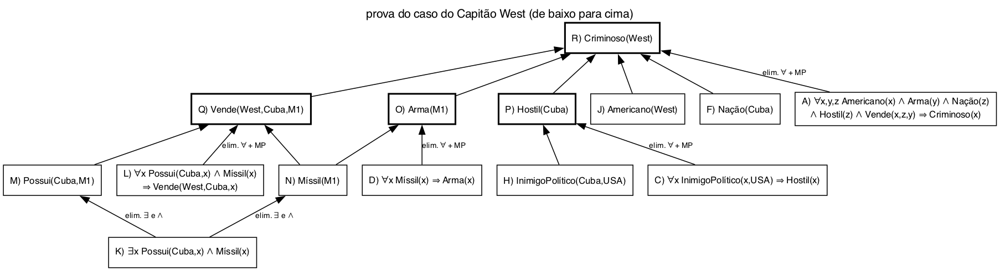

# Questão 4

Inferência por dedução é gerar um fato novo que sai COM CERTEZA dos fatos que já estão na base. Na lógica de predicados isso é feito aplicando regras de inferência nas sentenças, e na rede semântica é feito andando pelos arcos.

**Lógica de predicados**

Os tipos de inferência que aparecem no exemplo do West:

- Modus ponens: de P ⇒ Q e P, concluo Q. De Míssil(M1) ⇒ Arma(M1) e Míssil(M1), concluo Arma(M1).
- Eliminação do quantificador universal (∀): se vale pra todo x, vale pra qualquer constante. De ∀x Míssil(x) ⇒ Arma(x) posso escrever Míssil(M1) ⇒ Arma(M1). Foi o que o professor fez na aula trocando x por West, y por M1 e z por Cuba na regra A.
- Eliminação do quantificador existencial (∃): se existe algum x, dou um nome NOVO pra ele. De ∃x Possui(Cuba,x) ∧ Míssil(x) sai Possui(Cuba,M1) ∧ Míssil(M1). Tem que ser um nome novo porque eu só sei que existe um míssil, não qual.
- Eliminação da conjunção (∧): de P ∧ Q posso tirar P sozinho e Q sozinho. É assim que o K vira M e N.
- Introdução da conjunção: o contrário, de P e de Q formo P ∧ Q. Precisa disso pra juntar todos os fatos que a regra A pede antes do modus ponens.

O West passo a passo:

| Fato novo | Vem de | Inferência usada |
|:--|:--|:--|
| M) Possui(Cuba,M1) | K | eliminação do ∃ e da conjunção |
| N) Míssil(M1) | K | eliminação do ∃ e da conjunção |
| O) Arma(M1) | D e N | eliminação do ∀ e modus ponens |
| P) Hostil(Cuba) | C e H | eliminação do ∀ e modus ponens |
| Q) Vende(West,Cuba,M1) | L, M e N | eliminação do ∀ e modus ponens |
| R) Criminoso(West) | A, J, O, F, P e Q | eliminação do ∀ e modus ponens |

Uma coisa que notei: na versão em linguagem natural do slide o O vem "de D e N", mas não tem item N naquela lista, ele só existe na versão em lógica. O professor comentou isso na aula. Usei a versão em lógica.

**Redes semânticas**

Usando a rede da questão 2:

- Herança: um nó herda as propriedades dos nós de cima pelos arcos é-um e instância-de. Pra saber se o Piu-Piu tem asas eu subo Piu-Piu, Canário, Ave e acho "tem asas" na Ave. Em lógica isso é o mesmo que fazer modus ponens duas vezes seguidas (Canário(PiuPiu), Canário ⇒ Ave, Ave ⇒ TemAsas).
- Transitividade do é-um: se Canário é-um Ave e Ave é-um Animal, então Canário é-um Animal, mesmo sem ter esse arco direto.
- Herança com exceção: o que vem de cima é um valor padrão, e um nó mais de baixo pode trocar. Ave voa, mas Pinguim não voa, então pra Tux vale a informação do Pinguim, que é a mais próxima dele. Isso não tem na lógica pura, porque lá uma conclusão provada vale sempre.

## Resumo de como cheguei na solução

Pra lógica peguei o exemplo do West do slide e fui anotando qual regra foi usada pra gerar cada fato novo, assim saíram os tipos de inferência. O slide só cita modus ponens e eliminação do existencial e da conjunção, mas a eliminação do "para todo" acontece toda vez que uma regra com ∀ é usada, então coloquei ela também. Enquanto fazia a tabela vi que faltava o N na versão em linguagem natural.

Pra rede semântica o slide não fala de inferência, então peguei a rede que fiz na questão 2 e pensei em como responder perguntas nela. A herança foi a primeira, e escrevendo ela em lógica percebi que é modus ponens encadeado. O pinguim foi onde vi a diferença entre as duas.
