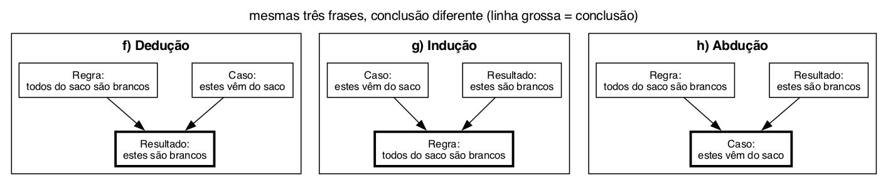

# Questão 5

Pra classificar olhei duas coisas em cada item: pra que lado o raciocínio vai (do geral pro particular, do particular pro geral ou de um particular pra outro) e se a conclusão é certa ou só provável.

**a) Indução**

Três casos particulares (ferro, ouro, cobre) e a conclusão é sobre TODOS os metais. Vai do particular pro geral, igual o exemplo dos professores do slide. Não é garantido, foram só três metais.

**b) Analogia**

Parte de um caso (a Terra) e chega em outro caso (Marte) só porque eles se parecem em algumas coisas. Vai do particular pro particular, sem nenhuma regra geral no meio, igual o exemplo do slide do João e da Maria com bebida. O "deve" no final já mostra que é só provável, e no caso está errado, porque as semelhanças escolhidas não são as que fazem um planeta ter vida.

**c) Dedução**

Tem uma regra geral (todos os alunos gostam de IA) e um fato (Francisco é aluno), e a conclusão sai das duas com certeza. É o modus ponens, mesma forma do "todo homem é mortal, João é homem":

```
∀x Aluno(x) ⇒ GostaIA(x)
Aluno(Francisco)
logo GostaIA(Francisco)
```

**d) Analogia**

Esse item está igual ao b no enunciado, então a resposta é a mesma: analogia, da Terra pra Marte por semelhança.

**e) Indução**

A premissa fala só dos alunos entrevistados e a conclusão fala de todos os alunos. Olha uma parte e generaliza pro todo. Quase marquei dedução por causa do "todos", mas é "todos os entrevistados", que é só uma amostra. Repara que é a mesma frase do item c, só que lá ela era a premissa e aqui é a conclusão.

**f), g) e h) Feijões**

Os três usam as mesmas três frases trocando qual é a conclusão. Chamei elas de:

- Regra: todos os feijões deste saco são brancos
- Caso: estes feijões vêm deste saco
- Resultado: estes feijões são brancos



**f) Dedução.** Regra + caso dá o resultado. Se todo feijão do saco é branco e esses vieram do saco, eles SÃO brancos, não tem como não ser.

**g) Indução.** Caso + resultado dá a regra. Peguei uns feijões do saco, eram brancos, concluí que todos do saco são. Pode ter um preto lá no fundo.

**h) Abdução.** Regra + resultado dá o caso. É a forma do slide: se vem do saco então é branco, eles são brancos, então suponho que vieram do saco. Mas podem ter vindo de outro lugar, igual o José do slide que podia ter câncer sem fumar.

## Resumo de como cheguei na solução

Fiz cada item comparando com os exemplos de cada tipo de raciocínio do slide e me perguntando se a conclusão era certa ou não. Na e eu ia errar por causa do "todos", e no d percebi que era cópia do b. Nos feijões usei a mesma separação da questão 3 em regra, caso e resultado, e aí ficou fácil: o tipo depende só de qual frase vira conclusão.
