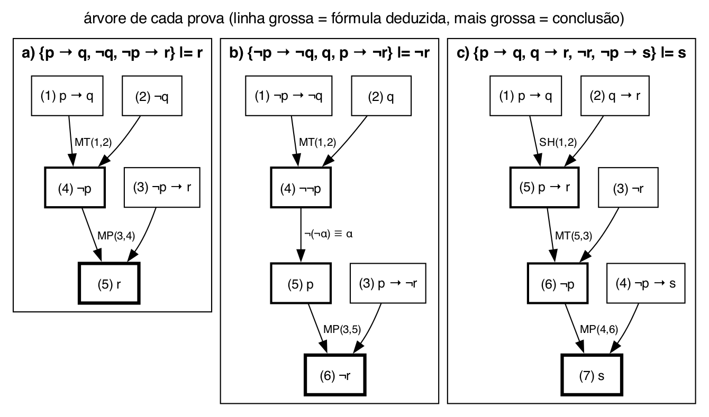

# Questão 3

Prova por regras de inferência é uma sequência de fórmulas onde cada linha ou é premissa (Δ) ou sai de linhas anteriores por uma regra da tabela. Na aula o professor chamou cada linha nova de fato novo na base: vai combinando as regras até o fato que eu quero aparecer. Usei o layout do slide do time, número, fórmula e de onde veio, com MP (modus ponens), MT (modus tollens) e SH (silogismo hipotético).

A estratégia que usei nos três foi a mesma: olhar pra conclusão, achar a premissa que TERMINA nela (vai ser uma implicação) e trabalhar pra trás pra conseguir o antecedente dessa implicação.

**a) {p → q, ¬q, ¬p → r} ⊢ r**

```
(1) p → q      Δ
(2) ¬q         Δ
(3) ¬p → r     Δ
---------------------
(4) ¬p         MT(1,2)
(5) r          MP(3,4)
```

Quero r, e r só aparece em (3) como consequente de ¬p. Então preciso de ¬p. Tenho p → q e ¬q, que é modus tollens direto e dá ¬p. Com ¬p e (3), modus ponens dá r.

**b) {¬p → ¬q, q, p → ¬r} ⊢ ¬r**

```
(1) ¬p → ¬q    Δ
(2) q          Δ
(3) p → ¬r     Δ
---------------------
(4) ¬¬p        MT(1,2)
(5) p          negação em (4), ¬(¬α) ≡ α
(6) ¬r         MP(3,5)
```

Quero ¬r, que está em (3) como consequente de p. Preciso de p. A premissa (1) tem p, mas negado no antecedente. Fazendo modus tollens de (1) com (2): o consequente de (1) é ¬q, e q é a negação dele, então ganho a negação do antecedente, que é ¬¬p. Essa linha ainda não é p, é p negado duas vezes. Pra tirar as duas negações usei a propriedade da negação do slide (¬(¬α) ≡ α) pelo princípio da substituição, que o slide de inferência por regras diz que pode ser usado numa linha da prova. Daí (5) é p e o modus ponens com (3) dá ¬r.

Quase escrevi p direto na linha (4), mas são duas linhas mesmo, porque o modus tollens devolve a negação do antecedente ao pé da letra, e o antecedente é ¬p. Tentei também contraposição em (1), vira ¬¬q → ¬¬p e cai no mesmo problema em dois lugares, então o MT é mais curto.

**c) {p → q, q → r, ¬r, ¬p → s} ⊢ s**

```
(1) p → q      Δ
(2) q → r      Δ
(3) ¬r         Δ
(4) ¬p → s     Δ
---------------------
(5) p → r      SH(1,2)
(6) ¬p         MT(5,3)
(7) s          MP(4,6)
```

Esse tem a mesma estrutura do exemplo do slide ({p → q, ¬p → r, q → s, ¬s} |= r), só mudou as letras e a ordem das premissas. Quero s, que está em (4) como consequente de ¬p. Pra chegar em ¬p tenho uma cadeia p → q → r e sei que ¬r. Primeiro junto a cadeia com silogismo hipotético, p → r, e aí modus tollens com ¬r dá ¬p. Modus ponens com (4) fecha em s.

Dava pra fazer sem o SH também: MT(2,3) dá ¬q, MT de (1) com esse ¬q dá ¬p, e depois o mesmo MP. Uma linha a mais, mesmo resultado. Preferi a versão com SH porque é a do slide e a ordem que o professor seguiu na aula (SH, depois MT, depois MP).



## Resumo de como cheguei na solução

Primeiro copiei as premissas como linhas Δ, igual o slide. Depois, em vez de sair aplicando regra em tudo, parti da conclusão: achei a implicação que tem a conclusão como consequente e fui atrás do antecedente dela. Nos três o antecedente dependia de uma negação que estava em outra premissa, e o modus tollens foi o que destravou. Na b percebi que MT devolve ¬¬p e não p, e precisei da propriedade da negação. Na c vi que era o exemplo do slide com outras letras e segui a mesma ordem: SH, MT, MP. Pra conferir, li cada linha de trás pra frente checando se os números que citei eram mesmo as linhas que a regra usa.
