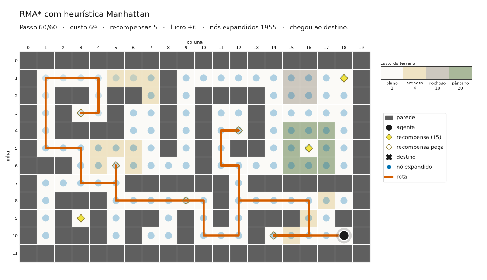
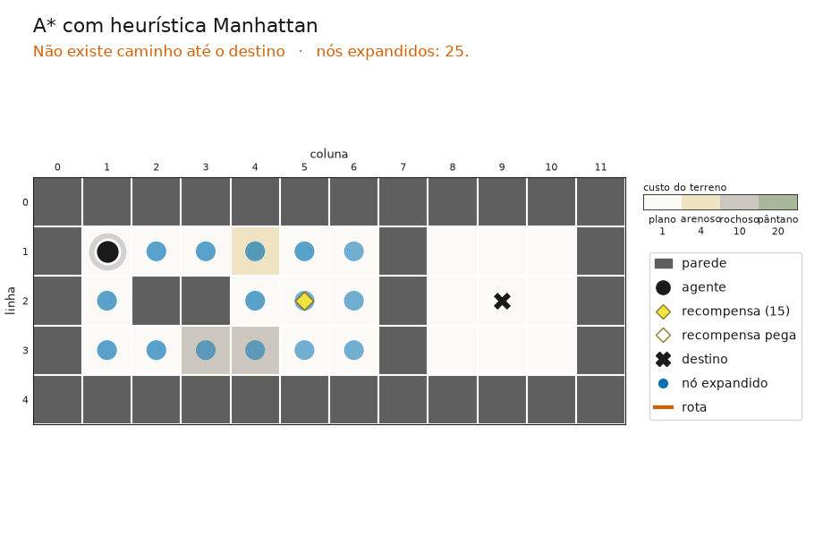
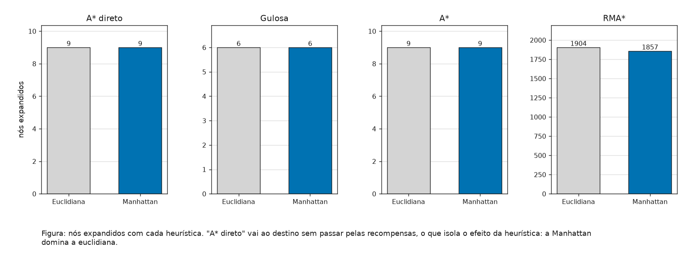
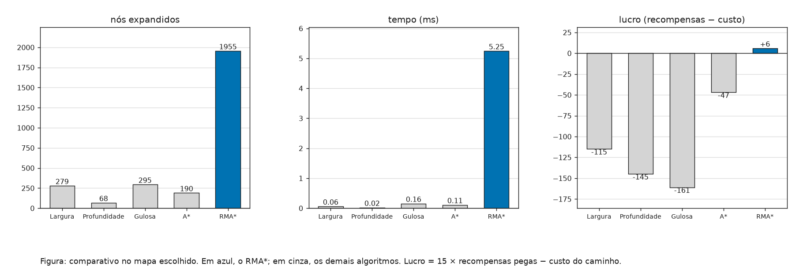
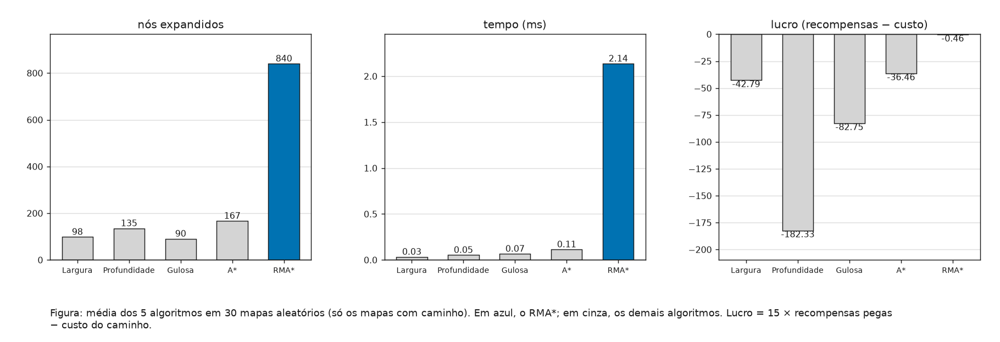

# Trabalho 1 - Busca

**Fundamentos De Inteligência Artificial** - UTFPR Campus Santa Helena

Docente: Thiago França Naves

Lucas Silva Maués - RA 2476878

Pedro Cangussu Fernandes Sales - RA 2503387

Sistema de navegação de um agente num grafo com terrenos, paredes e recompensas, resolvido com busca em largura, profundidade, gulosa, A* e, como algoritmo adicional, o RMA* (Cao et al., 2024).

## Como rodar

```
cd codigo
python3 painel.py     # interface com painel de botões
python3 main.py       # mesmo programa, com menu no terminal
```

Precisa do Python 3 com matplotlib (`pip install matplotlib`). O menu pede o mapa e a coordenada de destino (Enter = prêmio). Depois deixa animar cada algoritmo, mostrar o comparativo, trocar o destino, trocar a heurística (euclidiana ou Manhattan), comparar as duas heurísticas, trocar de mapa (desenhado ou aleatório) e comparar os algoritmos em 30 mapas aleatórios.

## Interface

O `painel.py` abre uma janela com o mapa à esquerda e os controles à direita, num layout inspirado no painel do PathFinding.js (Xueqiao Xu): escolha do algoritmo e da heurística, botões de buscar, trocar mapa (desenhado, sem caminho ou aleatório), comparativo, Euclidiana × Manhattan e 30 mapas aleatórios. Clicar numa célula do mapa muda o destino, e clicar numa parede mostra um aviso. As tabelas continuam saindo no terminal. O `main.py` faz as mesmas coisas por um menu numerado no terminal, no formato dos exemplos do enunciado.

A animação tem duas fases, no estilo das visualizações do PythonRobotics (Sakai et al., 2018): primeiro aparecem os nós que a busca expandiu, na ordem em que foram expandidos (o ponto fica mais forte quando o vértice é expandido mais de uma vez), e depois o agente percorre a rota pegando as recompensas. O título mostra o passo, o custo, as recompensas e o lucro acumulados.

O visual segue as figuras do próprio artigo do RMA*: padrão do matplotlib (fundo branco, fonte DejaVu Sans, eixos nomeados, legenda em caixa, gráficos com caixa, grade clara e contorno preto) e a paleta Okabe-Ito, a mesma das figuras do artigo, feita para ser legível por daltônicos. O azul marca os nós expandidos e o RMA*, o vermelhão marca a rota e o amarelo marca as recompensas. O terreno usa a cor suave do material, sempre do mais claro ao mais escuro conforme o custo, com uma barra de escala, porque custo é uma quantidade ordenada e claro/escuro é o canal mais eficaz para isso depois da posição (Mackinlay, 1986). Os marcadores são os de figura científica: círculo para o agente, losango para a recompensa (vazado quando é pega) e × para o destino. Embaixo do mapa fica uma legenda "Figura 1:", que descreve a figura e, ao fim da busca, traz o resultado, como nas legendas do artigo.



Quando não existe caminho, a busca esgota a região alcançável e a tela avisa:



## O ambiente

Cada célula andável do mapa é um vértice `(linha, coluna)` e se liga às vizinhas de cima, direita, baixo e esquerda (nessa ordem). Andar até uma célula custa o terreno dela.

| Símbolo | Significado | Custo |
|---|---|---|
| `.` | sólido e plano | +1 |
| `:` | arenoso | +4 |
| `^` | rochoso | +10 |
| `~` | pântano | +20 |
| `#` | parede | não passa |
| `A` / `P` / `$` | agente / prêmio / recompensa (valor 15) | +1 |

- `mapas/principal.txt`: 119 vértices e 8 recompensas. Tem um beco com recompensa no fundo, uma recompensa cercada de pântano (não compensa buscar) e uma sala fechada com recompensa dentro (sem caminho).
- `mapas/sem_caminho.txt`: o prêmio fica numa sala sem entrada, então todos os algoritmos têm que responder que não existe caminho.

## Modelagem

- **Estado inicial** = agente na célula `A`, nenhuma recompensa coletada
- **Função de teste** = agente na célula do destino
- **Função sucessor** = ∀ vizinho(x, y) se não parede(y) então mover(x, y) e se recompensa(y) então coletar(y)
- **Função de custo** = custo do terreno da célula de destino (1, 4, 10 ou 20)

## Como cada algoritmo trata as recompensas

| Algoritmo | Decisão |
|---|---|
| Largura / Profundidade | Busca cega não sabe se a recompensa vale a pena, então pega toda que **visitar** durante a busca: vai até ela e recomeça a busca dali até o destino. |
| Gulosa / A* | A heurística decide o próximo alvo: só desvia para um `$` se `15 > h(atual, $) + h($, destino) - h(atual, destino)`. Depois busca até o alvo usando a heurística escolhida. |
| RMA* | Procura a rota de **maior lucro** (valor dos `$` pegos − custo andado) e garante que ela é a melhor. |

A recompensa da sala fechada é escolhida como alvo pela gulosa e pelo A*, a busca falha e o agente desiste dela.

## Heurísticas

O menu deixa escolher entre duas heurísticas, e as duas são admissíveis porque o agente só anda em 4 direções e cada passo custa no mínimo 1:

- **Euclidiana**: distância em linha reta, `√(Δlinha² + Δcoluna²)`, a mesma ideia da distância em linha reta até Bucareste vista em aula.
- **Manhattan**: `|Δlinha| + |Δcoluna|`, o número mínimo de passos andando em 4 direções.

Como Manhattan nunca é menor que a linha reta e as duas são admissíveis, Manhattan **domina** a euclidiana, e o A* expande no máximo os mesmos nós com ela. O padrão do programa é Manhattan.

| Algoritmo | Euclidiana (nós / lucro) | Manhattan (nós / lucro) |
|---|---|---|
| A* direto ao prêmio, sem recompensas | 73 / custo 33 | **62** / custo 33 |
| Gulosa | 122 / -167 | 295 / -161 |
| A* com regra de desvio | 246 / -65 | **190** / **-47** |
| RMA* | 1962 / **+6** | 1955 / **+6** |

- **A\* direto**: a mesma rota ótima com menos nós. É a dominância na prática.
- **RMA\***: chega no ótimo (+6) com as duas, como esperado de uma heurística admissível.
- **Gulosa**: expande mais com Manhattan. A dominância garante vantagem só para o A*, porque a gulosa ignora o custo `g` e não tem garantia de otimalidade.



## RMA* (algoritmo adicional)

O problema de andar pegando recompensas sem gastar demais se chama, na literatura, **Orienteering Problem**. O RMA* (Reward Maximization A*) foi publicado no SoCS 2024 por um grupo da Carnegie Mellon para esse problema, e eu adaptei o Algoritmo 1 do artigo. Ele é um A* em que o estado também guarda quais recompensas já foram pegas:

- **label** = `(vértice, g, R)`, em que `g` é o lucro até aqui e `R` são as recompensas já pegas
- **h** = `15 × (recompensas que faltam) − h(vértice, destino)`, com `h` sendo a euclidiana ou a Manhattan: é o máximo de lucro que ainda dá para ter, então nunca subestima (admissível para maximização)
- abre primeiro o label de **maior** `f = g + h`
- **dominância**: no mesmo vértice, `l1` elimina `l2` se `g1 ≥ g2` e `R1 ⊆ R2`, porque quem tem mais lucro pegando menos ainda pode buscar o resto
- **incumbente**: guarda a melhor solução já achada e descarta todo label com `f` menor ou igual a ela

Diferenças para o artigo: lá a recompensa muda com o tempo e o caminho não repete vértice. Aqui a recompensa é fixa, então o label não guarda o tempo, e o caminho pode repetir vértice para voltar de um beco.

## Resultados

Mapa principal, destino = prêmio, heurística Manhattan (`codigo/saida-comparativo-principal.txt`):

| Algoritmo | Custo | $ | Lucro | Expandidos | Gerados | Tempo (ms) | Memória | Modelo prof. (tempo / memória) |
|---|---|---|---|---|---|---|---|---|
| Largura | 205 | 6 | -115 | 279 | 323 | 0,06 | 16,8 KB | 0,032 s / 323 KB |
| Profundidade | 175 | 2 | -145 | 68 | 101 | 0,02 | 7,4 KB | 0,010 s / 101 KB |
| Gulosa | 266 | 7 | -161 | 295 | 365 | 0,16 | 14,4 KB | 0,036 s / 365 KB |
| A* | 107 | 4 | -47 | 190 | 234 | 0,11 | 11,5 KB | 0,023 s / 234 KB |
| RMA* | **69** | 5 | **+6** | 1955 | 2265 | 5,25 | 334,9 KB | 0,227 s / 2265 KB |

O tempo medido varia um pouco a cada execução. O modelo do professor usa 10.000 nós gerados por segundo e 1 KB por nó.



As rotas de cada algoritmo estão em `imagens/rota-*.png`.

- Ir direto ao prêmio sem pegar nada custa 33 (lucro -33). O RMA* chega a +6, e esse valor foi conferido testando todas as ordens possíveis de recompensas.
- A gulosa pega mais `$` (7), mas a estimativa por Manhattan não vê paredes nem terreno, então ela aceita desvios que na prática saem caros.
- O RMA* expande uns 10 vezes mais nós que o A*, porque o mesmo vértice aparece com conjuntos de recompensas diferentes. É o preço de garantir a melhor rota.

## Mapas aleatórios

Além dos mapas desenhados, `codigo/gerador.py` sorteia um mapa novo: borda de parede, cada célula de dentro vira parede ou um dos 4 terrenos, e agente, prêmio e 6 recompensas caem em células sorteadas. O mapa só é aceito se tiver pelo menos 30 vértices e os 4 terrenos. O prêmio pode cair num lugar isolado, e aí os algoritmos têm que responder que não existe caminho.

A opção 11 do menu roda os 5 algoritmos em 30 mapas aleatórios (sementes 0 a 29, então o resultado se repete) e confere o lucro de cada um contra o ótimo calculado por força bruta, testando todas as ordens de recompensas:

| Algoritmo | Nós expandidos (média) | Lucro (média) | Achou o ótimo |
|---|---|---|---|
| Largura | 98,5 | -42,8 | 6/24 |
| Profundidade | 135,3 | -182,3 | 0/24 |
| Gulosa | 90,6 | -82,8 | 0/24 |
| A* | 167,3 | -36,5 | 2/24 |
| RMA* | 840,2 | **-0,5** | **24/24** |

Dos 30 mapas, 24 tinham caminho até o prêmio e nos outros 6 todos os algoritmos detectaram que não havia. O RMA* achou a melhor rota em todos os 24, o que mostra que o resultado não depende do mapa que eu desenhei.



## Resumo de como cheguei na solução

Comecei pela heurística, como o enunciado sugere. Para as buscas cegas, a regra literal do enunciado é pegar o que aparecer nos vértices visitados, então dividi a viagem em trechos: cada busca termina na primeira recompensa ou no destino. Para a gulosa e o A*, usei a heurística para estimar se o desvio até cada `$` é menor que o valor dele. Como essa estimativa erra em mapas com paredes e pântano, procurei como esse problema é tratado na literatura e encontrei o Orienteering Problem e o RMA*. Adaptei o RMA* tirando o tempo do estado e permitindo repetir vértice, e conferi o resultado dele por força bruta. Por fim, comparei a distância em linha reta vista em aula com a de Manhattan, que domina a primeira no grid de 4 direções. Para não depender de um mapa só, criei um gerador de mapas aleatórios e repeti a comparação em 30 mapas.

## Referências

RUSSELL, Stuart; NORVIG, Peter. **Inteligência Artificial: Uma Abordagem Moderna**. 3. ed. Campus, 2013.

CAO, Chao; XU, Jinyun; ZHANG, Ji; CHOSET, Howie; REN, Zhongqiang. Heuristic Search for the Orienteering Problem with Time-Varying Reward. In: **Proceedings of the International Symposium on Combinatorial Search (SoCS)**, v. 17, p. 11-19, 2024. DOI: 10.1609/socs.v17i1.31537.

TUFTE, Edward R. **The Visual Display of Quantitative Information**. Cheshire: Graphics Press, 1983.

SAKAI, Atsushi; INGRAM, Daniel; DINIUS, Joseph; CHAWLA, Karan; RAFFIN, Antonin; PAQUES, Alexis. PythonRobotics: a Python code collection of robotics algorithms. **arXiv:1808.10703**, 2018.

VANSTEENWEGEN, Pieter; SOUFFRIAU, Wouter; VAN OUDHEUSDEN, Dirk. The orienteering problem: A survey. **European Journal of Operational Research**, v. 209, n. 1, p. 1-10, 2011.
