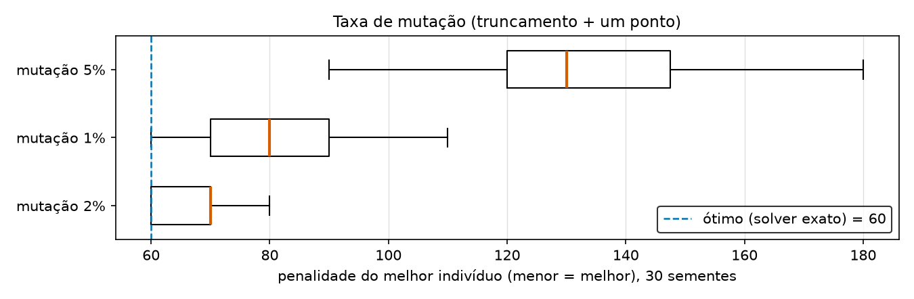
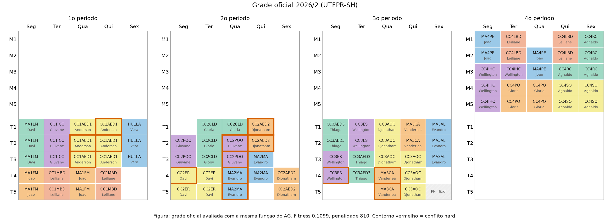
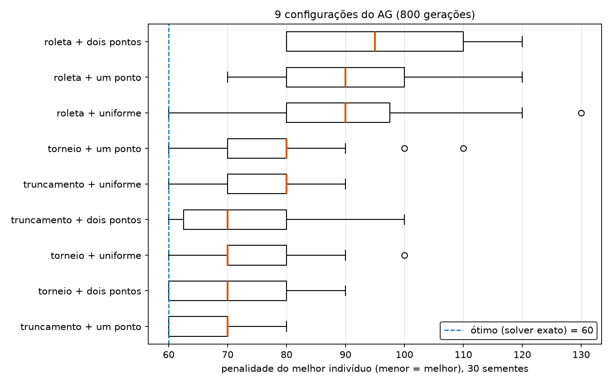
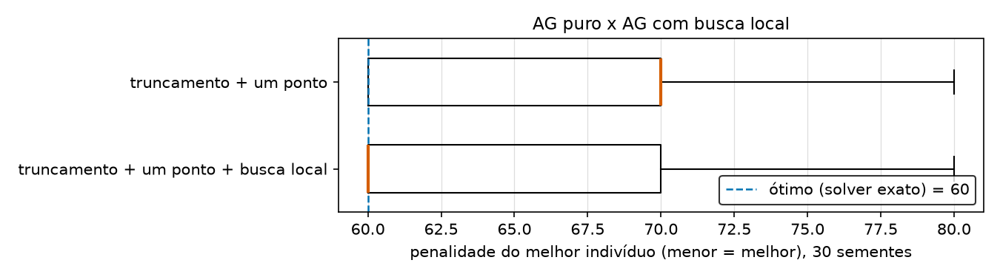
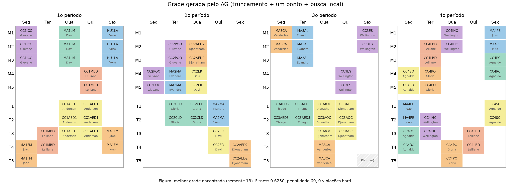
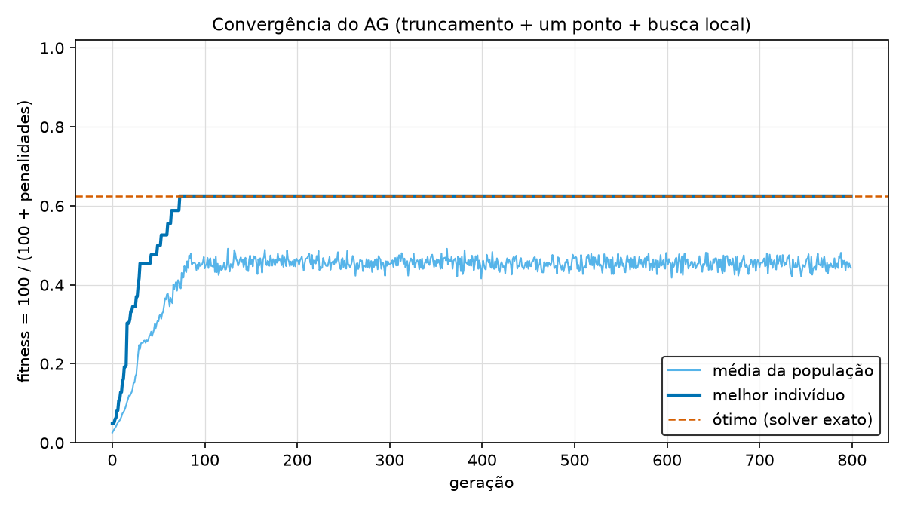

# Trabalho 2 - Algoritmo Genético

**Fundamentos De Inteligência Artificial** - UTFPR Campus Santa Helena

Docente: Thiago França Naves

Lucas Silva Maués - RA 2476878

Pedro Cangussu Fernandes Sales - RA 2503387

Algoritmo genético que monta a grade horária do 1º ao 4º período de Ciência da Computação da UTFPR Santa Helena, sem choque de horário de professor e sem choque entre pré-requisito e dependente. Os dados são os reais do semestre 2026/2: a matriz vigente do curso, os professores de cada disciplina e as aulas que esses professores já dão em outros períodos e cursos.

## Como rodar

```
cd codigo
python3 main.py
```

Precisa do Python 3 com matplotlib (`pip install matplotlib`). O menu deixa rodar o AG escolhendo a seleção, o cruzamento e se usa busca local, avaliar a grade oficial de 2026/2 com a mesma função do AG, ver os comparativos e trocar a leitura do pré-requisito.

Os comparativos rodam à parte, porque demoram (usam todos os núcleos do processador):

```
python3 comparativo.py                              # 9 configurações x 30 sementes (~15 min)
python3 comparativo.py mutacao truncamento um_ponto   # taxas de mutação 1%, 2% e 5% (~8 min)
python3 comparativo.py memetico truncamento um_ponto  # AG com busca local x 30 sementes (~40 min)
```

O solver exato precisa do OR-Tools, que ainda não instala no Python 3.14:

```
uv run --python 3.12 --with ortools python3 exato.py enunciado
```

## Os dados

| Arquivo | Conteúdo | De onde veio |
|---|---|---|
| `dados/disciplinas.csv` | 23 disciplinas do 1º ao 4º período: aulas por semana, pré-requisitos e professor | Matriz curricular do PPC vigente (2023 - atual, figura 3) e página "Matriz e Docentes" do curso (2026/2) |
| `dados/horarios.csv` | Horários M1 a M6 e T1 a T6 | Portal do Aluno |
| `dados/grade_oficial_2026_2.csv` | Todas as aulas dos 14 professores em 2026/2, inclusive em outros cursos | Portal do Aluno, "Mapa de Professor" |
| `dados/professores.csv` | Nome completo de cada professor | Página "Matriz e Docentes" |

Os pré-requisitos foram conferidos na figura da matriz. Em alguns casos o texto do PPC (quadro de cada disciplina) diz outra coisa: Arquitetura e Organização de Computadores não tem pré-requisito na figura e o texto cita Introdução à Ciência da Computação; Sistemas Operacionais tem só Arquitetura na figura e o texto cita também AED I. Usamos a figura, que é a matriz oficial.

O Projeto Integrador I não entra no cromossomo: na grade oficial ele é quase todo aos sábados (remoto) e no T6, fora dos horários que o AG usa. Ele fica com o horário fixo da grade oficial, como as disciplinas de outros departamentos no artigo da UFPB. A única aula dele que cai dentro da grade do AG é na sexta T5, então esse horário fica ocupado para o 3º período e para a professora.

As optativas que aparecem no Mapa de Professor (por exemplo a da professora Vera na turma do 4º) não entram: elas só bloqueiam o horário do professor, porque não são obrigatórias para a turma. Na grade gerada, por exemplo, Pesquisa Operacional ficou no mesmo horário da optativa da Vera (quarta T4 e T5), então quem fizer essa optativa teria choque.

## Modelagem

### Restrições

Pegamos as restrições do enunciado e completamos com as dos artigos indicados (UFPB e UFT):

| Restrição | Tipo | De onde |
|---|---|---|
| Professor com duas aulas no mesmo horário | hard | enunciado |
| Pré-requisito e dependente no mesmo horário | hard | enunciado |
| Duas aulas do mesmo período no mesmo horário | hard | UFPB (o aluno faz o período inteiro) |
| Professor dando aula num horário em que ele já tem aula em outro período ou curso | hard | UFPB ("horários disponíveis do professor") |
| Aulas da mesma disciplina juntas em menos dias do que blocos | soft | escolha nossa, a grade oficial faz assim |
| Janela (horário vago entre duas aulas do mesmo turno) | soft | UFT |
| Dia da semana sem nenhuma aula no período | soft | UFPB |
| Dia a mais que o professor precisa ir pra universidade | soft | UFPB ("maximizar disciplinas por dia para o professor") |

### Leitura do pré-requisito

Os dois artigos indicados fazem o contrário do enunciado: colocam a dependente no mesmo horário da pré-requisito, de propósito. A ideia da UFT é que quem reprova numa disciplina não pode cursar a dependente, então refaz a pré-requisito no horário dela e não perde nenhuma outra disciplina do período seguinte. O programa tem as duas leituras (opção 5 do menu):

- `enunciado` (padrão): pré-requisito e dependente não podem ter aula no mesmo horário (hard)
- `artigos`: a dependente deve ficar no horário da pré-requisito (soft)

Nas duas leituras só conta o pré-requisito direto, o que está na matriz (AED III depende de AED II, que depende de AED I, mas AED III x AED I não é conferido). Um aluno que está em AED III já passou por AED I, então não tem motivo pra separar as duas.

## Estratégias do algoritmo genético

O AG segue o ciclo da aula (Russell & Norvig, 2013): população inicial, avaliação, seleção, cruzamento, mutação, e repete até a condição de parada.

### Codificação do cromossomo

Igual ao artigo da UFPB e ao do CodeProject: cada gene é uma aula e o valor dele é o horário. A diferença é que a UTFPR dá as aulas em blocos seguidos (visto na grade oficial), então cada gene aqui é um bloco (a maioria das disciplinas da grade oficial é dividida assim):

- 3 aulas por semana: 1 bloco de 3
- 4 aulas por semana: 2 blocos de 2
- 6 aulas por semana: 2 blocos de 3

O horário é um número de 0 a 49 (`dia × 10 + aula`, com M1..M5 = 0..4 e T1..T5 = 5..9), e o valor do gene é onde o bloco começa. Um bloco só pode começar onde cabe inteiro no mesmo turno, então um bloco nunca atravessa o almoço. São 40 genes (22 disciplinas).

```
gene:    0       1       2      3      4      5      ...    39
bloco:   HU1LA   MA1FM   MA1FM  MA1LM  AED1   AED1   ...    LBD
valor:   42      1       33     12     26     35     ...    16
               (Seg M2) (Qui M4)
```

### População inicial

Cada bloco recebe um horário sorteado entre os horários onde ele cabe (UFPB). População de 200 indivíduos, o mesmo tamanho da UFPB.

### Função de avaliação (fitness)

Igual à UFPB: cada violação gera uma penalidade, 100 para hard e 10 para soft, e

```
fitness = 100 / (100 + soma das penalidades)
```

Vai de 0 a 1, e 1 seria uma grade sem nenhuma violação. As violações são contadas por aula, então duas aulas do mesmo professor no mesmo horário contam 1, três contam 2.

### Seleção

As três da UFPB: roleta (chance proporcional à fitness), torneio (sorteia 3 e fica o melhor) e truncamento (sorteia entre os 40% melhores, todos com a mesma chance).

### Cruzamento

As três da UFPB: um ponto, dois pontos e uniforme (máscara sorteada gene a gene). Taxa de cruzamento de 75%, como na UFPB.

### Mutação

Cada gene tem 2% de chance de receber um novo horário sorteado entre os horários onde o bloco cabe. A UFPB usou 5%, então testamos 1%, 2% e 5% na melhor configuração (truncamento + um ponto), com 30 sementes cada:

| Taxa de mutação | Média | Melhor | Pior | Chegou no ótimo |
|---|---|---|---|---|
| 1% | 81,7 | 60 | 110 | 2/30 |
| 2% | 69,0 | 60 | 80 | 9/30 |
| 5% | 134,0 | 90 | 180 | 0/30 |



Com 5% o resultado piora muito: com 40 genes, isso dá 2 mudanças por filho em média, o que estraga muito do que o cruzamento juntou. Com 1% a média também piora (81,7), provavelmente porque falta diversidade e o AG fica preso mais cedo. Por isso ficou 2%.

### Elitismo

O melhor indivíduo passa direto para a próxima geração (UFPB e CodeProject). O resto da população é trocado inteiro pelos filhos a cada geração (substituição geracional).

### Condição de parada

Número de gerações: 800 (UFPB), e nunca menos de 500, que é o mínimo do enunciado. O programa guarda em qual geração o melhor apareceu. Não para quando a fitness chega em 1, porque com as restrições soft isso não acontece (o ótimo é 0,625, ver abaixo).

## Resultados

O AG monta só as disciplinas do 1º ao 4º período, como pede o enunciado. As aulas que os mesmos professores dão do 5º ao 8º período e em outros cursos não entram no cromossomo, só bloqueiam aqueles horários (senão o AG poderia pôr o professor em duas salas ao mesmo tempo).

Os resultados abaixo são da leitura do enunciado (pré-requisito e dependente não podem ter aula no mesmo horário).

### A grade oficial de 2026/2

Antes de rodar o AG, passamos a grade que a UTFPR está usando em 2026/2 pela mesma função de avaliação. Ela tem 7 aulas em que pré-requisito e dependente estão no mesmo horário, e por isso a fitness é 0,1099 (penalidade 810, os outros 110 são de soft):

| Pré-requisito | Dependente | Quando |
|---|---|---|
| AED I (1º) | AED II (2º) | Qui T1 e T2 |
| AED I (1º) | POO (2º) | Qua T2 e T3 |
| Matemática Aplicada (2º) | Cálculo (3º) | Qua T4 e T5 |
| Engenharia de Requisitos (2º) | Engenharia de Software (3º) | Seg T4 |



Isso pode ser de propósito, porque é o que os artigos da UFPB e da UFT recomendam (dependente no horário da pré-requisito). Na leitura dos artigos, a grade oficial dá penalidade 620.

### Comparativo das 9 configurações

Igual à UFPB, testamos as 3 seleções com os 3 cruzamentos. A diferença é que a UFPB rodou cada configuração uma vez, e aqui cada uma rodou com 30 sementes diferentes (800 gerações cada), porque o AG é aleatório e uma execução só não diz qual estratégia é melhor. O ótimo (60) foi provado pelo solver exato, ver mais abaixo.

| Configuração | Média | Melhor | Pior | Chegou no ótimo | Geração do melhor (média) |
|---|---|---|---|---|---|
| roleta + um ponto | 93,3 | 70 | 120 | 0/30 | 550 |
| roleta + dois pontos | 97,3 | 80 | 120 | 0/30 | 517 |
| roleta + uniforme | 88,3 | 60 | 130 | 1/30 | 594 |
| torneio + um ponto | 77,3 | 60 | 110 | 3/30 | 410 |
| torneio + dois pontos | 72,3 | 60 | 90 | 9/30 | 476 |
| torneio + uniforme | 73,0 | 60 | 100 | 7/30 | 400 |
| truncamento + um ponto | 69,0 | 60 | 80 | 9/30 | 447 |
| truncamento + dois pontos | 74,7 | 60 | 100 | 8/30 | 432 |
| truncamento + uniforme | 75,7 | 60 | 90 | 5/30 | 415 |



O que dá pra tirar daí:

A roleta foi a pior, e por muito. Com essa fitness, um indivíduo com penalidade 70 (fitness 0,59) e um com 150 (0,40) têm chance parecida de ser escolhidos, então a pressão de seleção fica fraca. O torneio e o truncamento olham só pra quem é melhor, não pro quanto é melhor, e por isso foram bem melhores. Entre os dois a diferença é pequena, e o truncamento + um ponto teve a menor média e o menor pior caso.

O tipo de cruzamento mudou pouco e sem um padrão: no torneio o um ponto foi o pior, no truncamento foi o melhor. Com 30 sementes essas diferenças de poucos pontos podem ser só sorte.

O que chamou atenção é que nenhuma configuração chegou no ótimo em mais de 9 das 30 execuções. O AG chega perto rápido (em torno de 70), mas trava ali, e foi isso que levou ao próximo teste.

### AG com busca local (algoritmo memético)

O AG trava perto do ótimo porque, quando falta só trocar um bloco de lugar, a mutação acerta isso só por sorte. A solução que a literatura de grade horária usa é o algoritmo memético (Burke, Newall & Weare, 1996): depois do cruzamento e da mutação, uma parte dos filhos passa por uma busca local. Aqui foi a subida de encosta (*hill climbing*), em 10% dos filhos: sorteia 4 genes e, para cada um, testa todos os horários possíveis e fica com o que melhor diminui a penalidade. O artigo da UFT faz parecido, com uma função de reparo depois da mutação (Nunes et al., 2013, citado por Descardeci et al., 2017).

Rodamos na melhor configuração (truncamento + um ponto), com as mesmas 30 sementes:

| Configuração | Média | Melhor | Pior | Chegou no ótimo | Geração do melhor (média) |
|---|---|---|---|---|---|
| truncamento + um ponto | 69,0 | 60 | 80 | 9/30 | 447 |
| truncamento + um ponto + busca local | 64,7 | 60 | 80 | 19/30 | 260 |



Com a busca local o AG chega no ótimo em 19 das 30 execuções (contra 9) e o melhor aparece bem mais cedo (geração 260 em média, contra 447). O pior caso ficou igual (80). O custo é o tempo: cada execução ficou umas 15 vezes mais lenta (589 s contra 40 s, rodando várias em paralelo), porque cada gene testado na busca local é uma avaliação a mais.

### A melhor grade

Uma das execuções que chegaram no ótimo (semente 13, truncamento + um ponto + busca local):



Ela não tem nenhuma violação hard: nenhum professor em dois lugares, nenhum choque dentro do período, nenhum professor num horário em que ele já dá aula em outro curso, e nenhuma pré-requisito no mesmo horário da dependente (AED I, por exemplo, ficou nas tardes de quarta e quinta, e AED II, que depende dela, na quarta de manhã e na sexta à tarde). A sexta T5 do 3º período, que é do PI-I, ficou livre. A penalidade de 60 é toda de soft, 6 dias a mais que algum professor precisa ir pra universidade. Na leitura do enunciado, isso é bem melhor que a grade oficial (810).

A convergência dessa execução:



O melhor indivíduo chega no ótimo na geração 73 e não muda mais até a 800. A média da população fica em torno de 0,45 o tempo todo, porque a mutação e o cruzamento continuam gerando filhos piores (o que mantém a diversidade).

### Solver exato (para saber o quanto o AG chegou perto)

Um AG não garante que achou a melhor grade. Pra saber se 60 era bom ou ruim, modelamos o mesmo problema (mesmas restrições, mesmos pesos) num solver de programação por restrições, o CP-SAT do Google OR-Tools (`codigo/exato.py`). Ele provou que 60 é a menor penalidade possível na leitura do enunciado, então as execuções que chegaram em 60 acharam uma grade ótima.

Esse 60 vem de 6 dias a mais de professor, e não chega em 0 porque é inevitável: a disponibilidade dos professores (aulas em outros períodos e cursos) não deixa juntar todas as aulas de cada um em menos dias.

O solver não substitui o AG (o trabalho é sobre o AG), ele só serve pra comparar. Na leitura dos artigos o problema fica bem maior (a restrição "dependente no horário da pré-requisito" junta tudo), e em 2 minutos o solver achou penalidade 370 sem conseguir provar que é a menor. Rodando o AG uma vez nessa leitura (truncamento + um ponto, semente 0), ele chegou em 410, contra 620 da grade oficial.

### Limitações

O modelo simplifica algumas coisas da grade real. O AG espalha as aulas de manhã e de tarde, mas na grade oficial do 1º ao 3º período é tudo à tarde e o 4º é de manhã; isso não entrou como restrição. Salas e laboratórios também ficaram de fora. E a contagem de "dias a mais do professor" só olha a grade do AG (segunda a sexta, M1 a T5): aulas no M6, no T6 e no sábado bloqueiam o professor, mas não contam como dia que ele já vai pra universidade. Então o 60 é o ótimo desse modelo, não da grade real completa.

## Conclusão

O AG resolveu o que o enunciado pede: em todas as execuções da melhor configuração a grade saiu sem choque de professor e sem pré-requisito no horário da dependente, usando os professores e as aulas reais de 2026/2. Das estratégias, a seleção foi o que mais fez diferença (roleta bem pior que torneio e truncamento), e o cruzamento quase não mudou o resultado. Sozinho, o AG chega perto do ótimo mas trava; com a busca local (algoritmo memético) ele chegou no ótimo provado pelo solver em 19 das 30 execuções.

## Referências

SANTOS, J. L. L. **Uma ferramenta para geração de grades horárias utilizando algoritmos genéticos**. Trabalho de Conclusão de Curso (Bacharelado em Sistemas de Informação), UFPB, Rio Tinto, 2016.

DESCARDECI, J. R.; MANTOVANI, M. A.; SALAZAR NETO, F. Aplicação de algoritmos genéticos para criação de grade horária interconectada para um curso de Engenharia Elétrica. In: **I Simpósio de Estudos em Engenharia Elétrica do Tocantins (SEELTO)**, Palmas, 2017.

JANKOVIĆ, M. Making a class schedule using a genetic algorithm. **CodeProject**, 2008.

BURKE, E. K.; NEWALL, J. P.; WEARE, R. F. A memetic algorithm for university exam timetabling. In: **Practice and Theory of Automated Timetabling (PATAT 1995)**. Lecture Notes in Computer Science, v. 1153, p. 241-250. Springer, 1996.

PERRON, L.; FURNON, V. **OR-Tools** (CP-SAT), versão 9.15. Google. Disponível em: <https://developers.google.com/optimization>.

UTFPR. **Projeto Pedagógico do Curso de Bacharelado em Ciência da Computação - Santa Helena** (2023 - atual).

RUSSELL, S.; NORVIG, P. **Inteligência Artificial: Uma Abordagem Moderna**. 3. ed. Campus, 2013.
